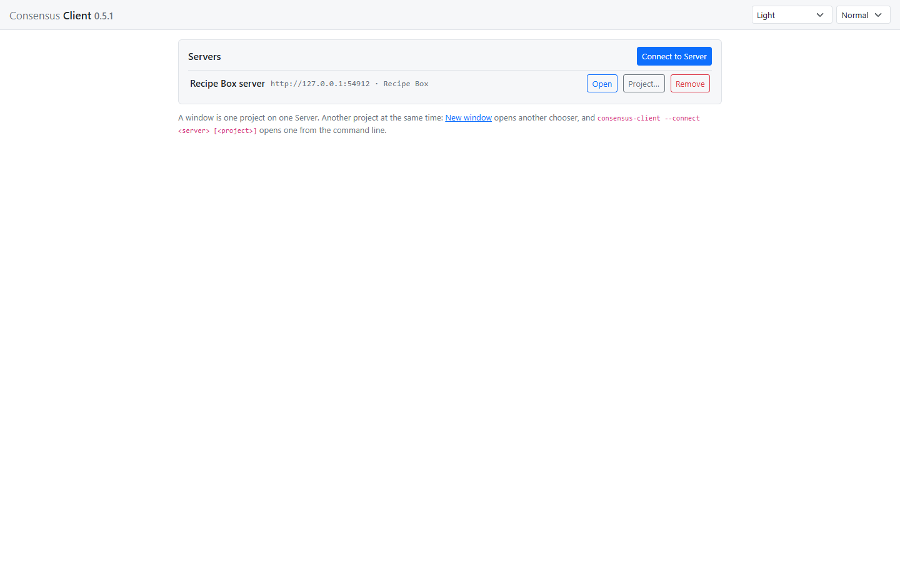
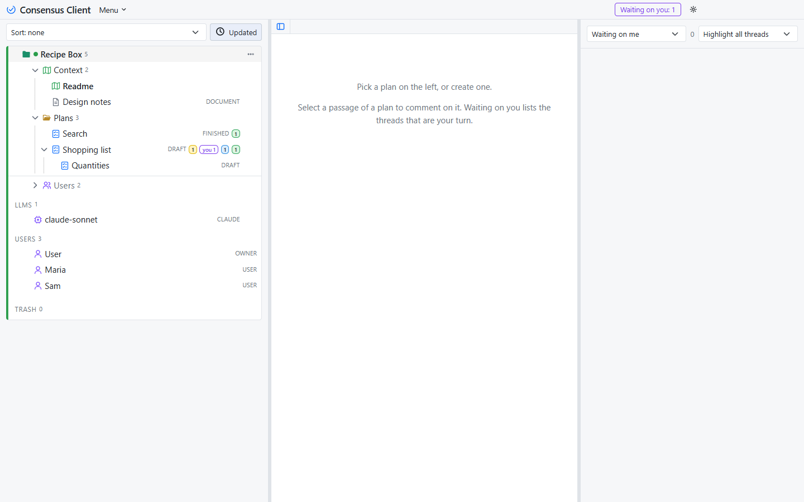
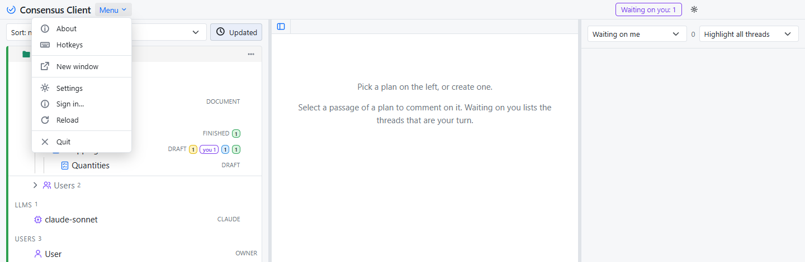

# Consensus Client

**Consensus Client** opens one project on one Consensus Server per window: the shape for working on one thing, with an agent session beside you, in a project that lives on a Server. It has no local folder and no server of its own; the Server signs you in on its page and decides, by your role, what you may see and do. It installs beside Consensus Sidecar, Consensus Desktop and Consensus Server and changes none of them.

## Installing and starting it

On Windows, run `Consensus-Client-Setup-<version>.exe` from the [latest release](https://github.com/mchiver/consensus-ai/releases/latest); it puts **Consensus Client** in the Start menu.

From the command line, or from the checkout:

```
"Consensus Client.exe" [--connect <server> [<project>]] [--config <folder>]
npm run client -- [--connect <server> [<project>]] [--config <folder>]
```

`--connect` names a Server you saved, and after it a project of that Server, by its id or its name; with no project the Server's last project opens, and with none yet the chooser lists the Server's projects to pick from. With no `--connect` the window opens on the chooser. The Client has no `--port`: its page is served on a free port of this machine, remembered between starts. A bare folder on the command line is refused: the Client opens no folder; [Consensus Sidecar](sidecar.html) does.

## The chooser

A window with no project shows the **chooser**: the Servers you connected to, and **Connect to Server**.



- **Connect to Server** takes a name of your choosing and the Server's address (`https://consensus.example.com`, or `http://127.0.0.1:3500` for the Server on this machine), then **Try**. A Server that lets you in without a sign-in lists its projects to pick one; a Server that asks for a sign-in says so, and **Connect** opens the whole Server in the window, where you sign in and see the projects you may. The Server is saved under its name, with the project you picked as its last.
- Each saved Server has **Open**, which opens its last project (or the whole Server, when none was picked yet), **Project…**, which lists its projects again to pick another, and **Remove**, which drops the entry and tells the Server nothing.

**New window** (Ctrl+N, or the window's menu) opens another chooser: a window is one project, and another project is another window.

## Signing in

A Server takes no request without a sign-in, so its page shows Consensus-AI's sign-in box when the window opens on it; sign in with your Consensus-AI account and you are who you are on that Server, with your roles in its projects. Any account will do: Registered, the free tier, is enough. The sign-in is kept in the window and handed to the Client, which writes it as this machine's signed-in person (`<config>/user.json`, shared with the Server application on the same machine, so a sign-in here counts there too). **Sign out** is in the window's menu.

## The window

The page shows the one project: its tree, open, with the Trash beneath it. The window has no frame of its own: the page's title bar is the window's, the minimize, maximize and close buttons sit over its right end in the palette's colours, and the bar drags the window.



Plans, documents, folders, threads, revisions, reports, Export and the look work as they do everywhere, as far as your role in the project allows; the project's settings, its LLM Instructions and the Server's own settings are there for the Administrator and the Managers, as on the Server's page. The Server's LLM tasks run on the Server, as you, from the buttons on a plan's heading and from the LLM page.

The title bar's **Menu** has New window, **Settings** (the project's, or the Server's for its Administrator and Managers), **Sign in…** or **Sign out**, Reload and Quit; Ctrl+N and Ctrl+R do the same, and F11 goes full screen.



## An agent beside the window

The window has an address of its own on this machine, `http://127.0.0.1:<port>`, printed when the Client starts and kept as `page-port` in `client.json`, and it serves what a Server serves an agent session: `/instructions`, composed for this window (the Server behind it, the project open in it, the token rule) over the common guide; `/api`, every call forwarded to the window's Server with your sign-in added to a request that carries none, so the agent acts as you and may do what your roles allow (a request with its own token is passed as it is); and `/api/mcp`, the same tools as the Server's, each call the Server's request. Start an agent session beside the window with one line:

> Read the instructions at `http://127.0.0.1:<port>/instructions` with curl, then load your context.

For an MCP client, the stdio relay from a checkout takes the window's address and needs no token: `node <checkout>/bin/mcp.js --server http://127.0.0.1:<port> --service Claude-CLI`. Until you sign in, a request with no token is answered 401 "sign in"; on the chooser, with no Server open, 503.

## Settings

The Client keeps its settings in `client.json` in the config folder (`<your home>/.consensus`, unless `--config` names another), beside the Desktop's `desktop.json` and the Server's `consensus.json`: your Servers, each with the project you opened on it last, the theme and the size, and the view as you left it. Nothing is carried over from the Desktop's file.

## What the Client leaves out

The Client opens no local folder and starts no server: a folder of your own is [Consensus Sidecar](sidecar.html)'s, and several Servers at once are [Consensus Desktop](getting-started.html#the-desktop)'s. Everything else is the Server's to give, by your role.
