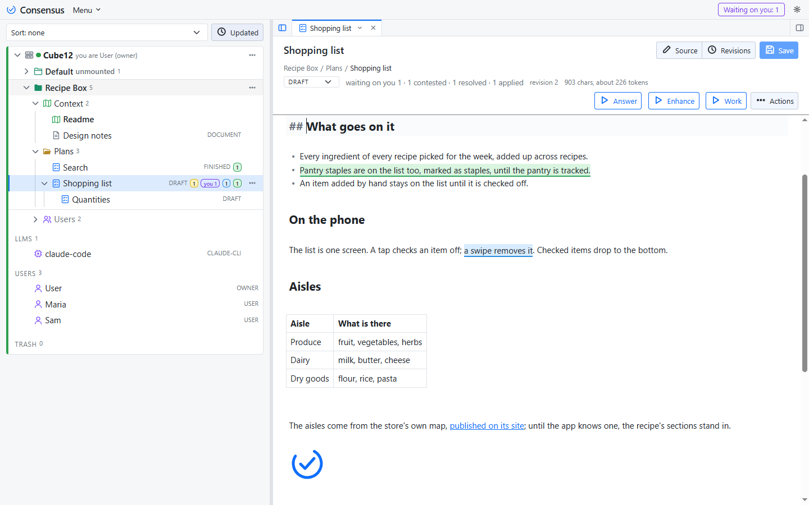
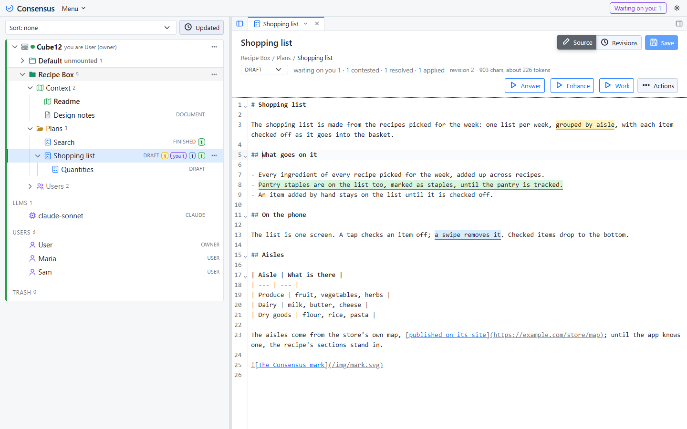
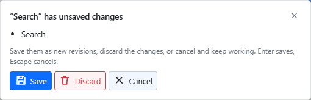
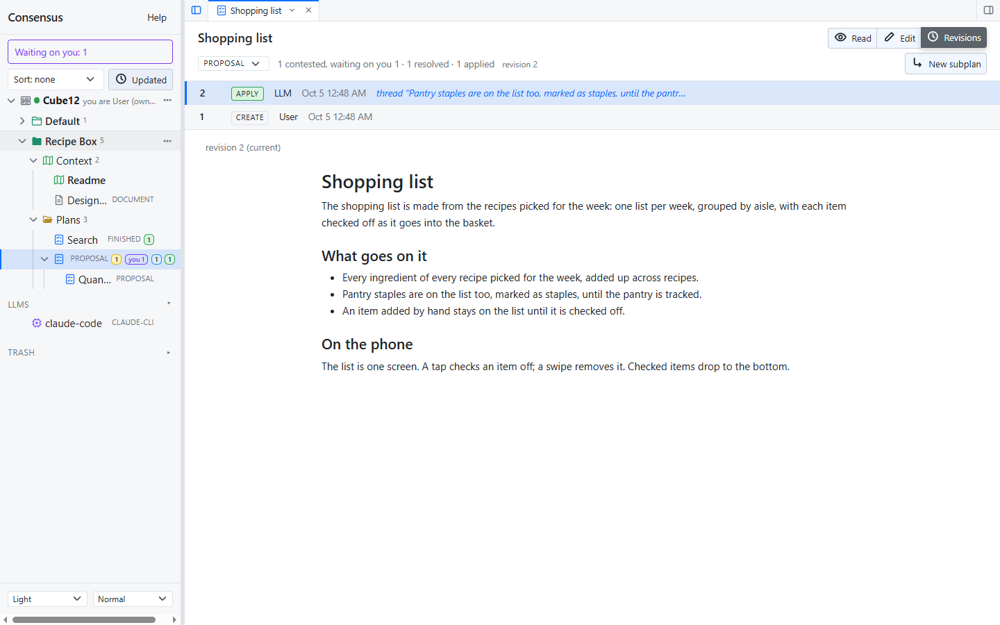
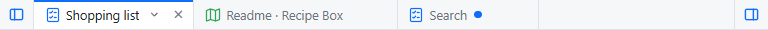

# Editing and revisions

A plan or document opens in the **editor**, which is the one view of its text: the markdown is rendered in place as you read it, and the line your cursor is on shows its source, the way Obsidian's Live Preview does. You read and write in the same place. The heading has **Source**, which shows the plain markdown instead (Ctrl+E; the choice is remembered), **Revisions**, the record, **Save**, lit while you have unsaved changes, and **Discard** beside it while you do. The heading also has the location line (server / project / folder / parent plan, each a link that shows its row in the tree), the state, the revision and the text's size: the characters, and about a quarter as many tokens.

## What renders in place

Headings, emphasis, strikethrough and inline code; links, shown as their text (Ctrl+click opens the URL, a plain click edits); bullet and numbered lists; task checkboxes, which a click toggles; blockquotes; fenced code blocks, with a bar naming the language above the code; horizontal rules; tables, rendered, a click into one showing its source; and images. Raw HTML, entities and link references stay as written. Move the cursor onto a line and its syntax is back; move it off and the line renders again. **Source** shows everything as written, with line numbers and folding, and the keys you know work in both: multiple cursors, find and replace.

## The threads in the text

The threads' passages are highlighted in the editor by state, as in the pane, and the highlight picker in the pane applies. A click on a highlight selects its thread (the next one, on a passage with several), and clicking a thread's quoted words in the pane scrolls the text to its passage and flashes it. Selecting text offers **Copy**, which copies the text as it reads, **Comment** and **Start a new Subplan**, and **Re-anchor here** while a thread is being re-anchored. Comment and Start a new Subplan need the saved text, so after an edit, save first; until then Copy alone is offered. A document has no threads and offers Copy alone.

## Saving

Typing never makes a revision; **Save** (Ctrl+S) does, one revision per save. While you have unsaved changes the tab shows a dot, and the draft is kept with the tab: switch tabs and back, or restart, and it is there as you left it. A newer revision arriving while your text is clean, a thread applied or a save elsewhere, is taken silently, the cursor and the scroll staying where they were. While you have unsaved changes it is not: a line above the editor says the text changed and names the revision, Save is off, and **Discard** takes the server's text; copy what you need first. Two people cannot overwrite each other that way: a save carries the revision it was made from, and a stale one is refused. An archived plan opens read-only, and so does the text of an old revision.

Editing is allowed at any time. A manual edit changes no thread's status, and the anchors follow the text, so you can tidy a plan while its threads are open.

## Closing with unsaved changes

Closing a tab that holds a draft asks: **Save**, **Discard** or **Cancel**. Close others and Close all ask the same when any tab they would close is dirty, listing the documents that would lose their changes; a draft whose plan moved on since is marked as one that cannot be saved, and Save saves the others and keeps it. The desktop's window close asks the same way, and so does Quit; a browser shows its own prompt before the page is left. **Confirm on close**, behind the gear in the title bar, turns the window's and the browser's prompts off; a tab's own close always asks. Off, nothing is lost: the drafts are kept with their tabs and come back next time.

## Monaco mode

The **Editor** setting behind the gear can pick Monaco, the editor of VS Code, instead of CodeMirror. The page then works as it did before the one view: **Read** shows the rendered text with the threads' passages, **Edit** opens Monaco beside a live preview, with a **Preview** button, Save and Discard in the editor's bar, and Ctrl+E switches between Read and Edit, from the editor too, saving first. Monaco neither renders the markdown in place nor marks the threads' passages. The setting takes effect at once, is remembered in the browser, and the comment and reply boxes follow it.

## Revisions

Every save, and every applied thread, is a revision. **Revisions** lists them, newest first: who, when, which thread was applied and its outcome, and the text as it stood, read-only; pressed again, the editor comes back. The document keeps no change log of its own; the revisions and the applied records are the record.

## Tabs

Every item you open, and Waiting on you, opens in a **tab** above the document: one tab per item, dragged to reorder, closed with ×. Each tab comes back as you left it, the editor or Revisions, an unsaved edit included, and a dot on the tab says the edit is there. The thread filter and the highlight are not the tab's: they are the page's, the same in every item, and remembered in the browser. Open tabs come back after a restart, per server; a tab whose item is gone from the server is dropped. With none open, the start page shows.

A tab's menu (the ▾ beside its ×, or a right-click) has Close, Close others, Close to the right, Close all, and **Detach**, which opens the item in its own browser window, without the sidebar; allow pop-ups for the page. Its tab stays in the strip, ghosted, and its menu has **Re-attach** and Close. Re-attach in the window does the same, and **Hide threads** / **Show threads** beside it hides or shows the window's threads pane, a choice the window keeps to itself. Two windows, and two browser tabs, stay in step: every change is pushed live.

## The threads pane and the tree

The small button at the right end of the tab strip hides or shows the threads pane, and its mirror at the left end the project tree (Ctrl+Shift+T and Ctrl+Shift+E do the same); each is remembered in the browser. A document gives the threads pane's room to the text.

The project tree's state per server, the open project, the folded folders and the LLMs fold, is remembered under the server; the sort order, the open tabs, the look of the page, the hidden panes and the pane widths, are the window's, whatever the servers it shows.

## Hotkeys

**Menu > Hotkeys** in the title bar lists them. Ctrl reads as Cmd on a Mac.

| Keys | What |
| --- | --- |
| Ctrl+E | Source on or off; in Monaco mode Edit, and from Edit save and read |
| Ctrl+S | Save, staying in the editor |
| Ctrl+C | Copy the open item's export (not while typing, nothing selected) |
| Ctrl+V | Paste into the open project (not while typing) |
| Escape | Close the menu or the popup; deselect the thread |
| Ctrl+Shift+E | Show or hide the project tree |
| Ctrl+Shift+T, or Ctrl+Shift+H | Show or hide the threads |
| Ctrl+Shift+C | Comment on the whole document |
| Ctrl+P | Report: the open plan, its Subplans and all their threads as one page to print |
| Ctrl+PgUp, or Alt+PgUp | Previous tab, wrapping to the last |
| Ctrl+PgDn, or Alt+PgDn | Next tab, wrapping to the first |
| Ctrl+Home, or Alt+Home | First tab |
| Ctrl+End, or Alt+End | Last tab |
| Ctrl+F4, or Alt+W | Close the tab |

In a browser, Ctrl+PgUp, Ctrl+PgDn, Ctrl+Shift+T and Ctrl+F4 are the browser's own and never reach the page; the second key of each does. In the desktop both work. The keys work in the editor too, but Ctrl+Home and Ctrl+End, which are the editor's own there (Alt+Home and Alt+End go to the first and last tab from the editor). Escape closes the open popup wherever the focus is; every popup also has an × at its top right.

The editor has keys of its own, listed under the page's in Menu > Hotkeys: Ctrl+Up and Ctrl+Down scroll a line with the cursor staying; Ctrl+B puts `**` around the selection, or the word at the cursor, and takes it off again; Ctrl+I does the same with `_`; Ctrl+Home and Ctrl+End go to the start and the end of the text. Each tab remembers where its text was scrolled and where the cursor stood, so switching tabs and back finds the editor as you left it.

The desktop window has keys of its own, listed under the page's in Menu > Hotkeys:

| Keys | What |
| --- | --- |
| Ctrl+R | Reload the page |
| Ctrl+N | New window: a second instance of the app |
| Ctrl+Shift+O | Open folder in new window: that folder's project alone |
| F12, or Ctrl+Shift+I | The developer tools |
| Ctrl+0, Ctrl+=, Ctrl+- | Zoom: reset, in, out |
| F11 | Full screen |
