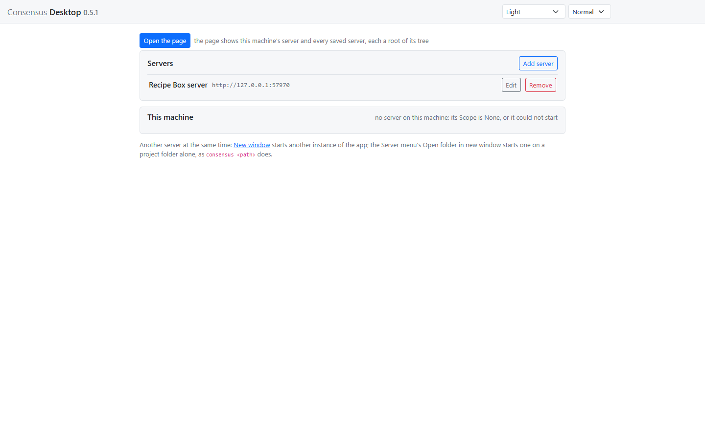

# Getting started

Consensus-AI is a web application you run yourself. It keeps your plans as plain files in a folder, shows them in a browser, and lets an LLM take part through its API. This page gets it running in the four ways there are: from the checkout, in Docker, as the desktop application from the checkout, and from the Windows installer.

The code is public at [github.com/mchiver/consensus-ai](https://github.com/mchiver/consensus-ai). The Windows installer is on the [releases page](https://github.com/mchiver/consensus-ai/releases/latest); the other ways start from the checkout.

Consensus-AI is not [Consensus](https://consensus.app), the research search engine at consensus.app, and has no connection to it. Consensus-AI is a tool for settling a plan with your LLM, thread by thread.

## From the checkout

You need Node 22 or later and git.

```
git clone https://github.com/mchiver/consensus-ai.git
cd consensus-ai
npm install
node bin/consensus.js
```

The server prints its address and scope, its config folder, its settings file and the projects it loaded:

```
Consensus at http://127.0.0.1:3500/ (Scope Local, listening on 127.0.0.1)
config folder C:\Users\you\.consensus
settings written to C:\Users\you\.consensus\consensus.json
project Default at C:\Users\you\.consensus\projects\Default
no window: this is the headless form; open the address in a browser, or run the desktop (npm run desktop); Ctrl+C stops the server
```

Open `http://127.0.0.1:3500/` in a browser. You are the owner, and you see the **Default** project with its Context folder and an empty Readme.


Across the top runs the **title bar**: the brand, a **Menu** (About, with the version, the links and a summary of every project's threads; Hotkeys; and, in the desktop, the window's commands), **Waiting on you** with the count of threads that wait on you on every server, **Running** while an LLM run is in progress, and a gear for the look: the theme, the size, the editor and Confirm on close.


The config folder holds the settings, and the projects that were made with no folder of their own; a project is a folder with a `.consensus` in it (the page [Settings](settings.html) has the layout). A path and four options change where and how it runs:

| Option | What it does |
| --- | --- |
| `<path>`, or `--project <folder>` | one project alone, the way an editor opens a folder: the folder's project is served and no other, its `.consensus` made when it has none (named after the folder, with an empty Readme), and the folder goes to the top of the settings' project list, so a plain start shows it next time; `consensus .` is the folder you are in |
| `--config <folder>` | the config folder; `.consensus` in your user folder by default (`--data` is its older name) |
| `--port <port>` | the port; the settings' Port, 3500 by default. When that port is in use (another instance), a free one is taken and printed, so two folders can be open at once; a port given here is not given up |
| `--scope none`, `local` or `public` | for this start, in place of the settings' Scope: `local` listens on this machine only, `public` on every interface, `none` starts no server (taken as `local` when a path is given: that project needs its server) |
| `--headless` | accepted here and does nothing: this form never has a window |

Listening beyond your own machine is a decision: anyone who can reach the server acts as the owner. Keep the Scope Local unless the network is yours. A settings file from before, with a `Host`, is brought up to date at the next start: a local address becomes Scope Local, any other Public.

## In Docker

The repository holds a `Dockerfile` and a `compose.yaml`. From the checkout:

```
docker build -t consensus:latest .
docker compose up -d
```

The image runs the server with `--config /data --scope public --port 3500 --headless`: it listens on port 3500 and keeps its config and data in the `consensus-data` volume. `docker compose down` stops it; the volume stays. The `compose.yaml` as shipped publishes the port on every IPv4 address of the host, because it is written for a server on a private network; edit it for your own.

## The desktop

Consensus Desktop is the same page in a window of its own, with a Consensus server of its own inside. It is the other entry point of the one program: it takes the same path, `--config`, `--port`, `--scope` and `--headless`, starts the server from the config folder as its Scope says, and keeps its own settings (the saved servers, the theme, the remembered view) in that same settings file. From the checkout:

```
npm run desktop
npm run desktop -- W:\projects\tic-tac-toe
npm run desktop -- --config W:\consensus --headless
```

It opens on the page with every server it has, each a **root** of the tree: its own server first, when it runs, then every saved server; with a path it shows its own server with that project alone. The **servers screen** (Servers… in the title bar's Menu) keeps the list, and is where the app opens when it has no server to show.



- **Servers** lists the servers you saved. **Add server** asks for a name and a URL, tries the address before saving it, and says which Consensus version answers.
- **This machine** is the app's own server: it starts with the app, from the settings' Scope and Port, and stops with it; the page shows it first. With Scope None there is none, and the page shows the saved servers only; the configured port in use gives way to a free one, and a port asked for on the command line that is in use shows the reason here. With a path on the command line the line says which project the server is on alone. **Open the page** goes back to the page.

The page shows the servers at once: a row per server at the top of the tree, with its name, a dot that is green while its updates are live, who you are there, and a menu with New Project, Import, Settings, Servers… and Reload; beneath it that server's projects, LLM connections and Trash. A server that does not answer stays in the tree, offline, with the reason in its tooltip, and is read again when it answers. Every action goes to the server its row belongs to; an item moves within its server, and Copy and Paste carry a plan to another server, with new ids. The window has no frame of its own: the page's title bar is the window's, the minimize, maximize and close buttons sit over its right end in the palette's colours, and the bar drags the window. In the desktop its **Menu** also has Servers…, New window for a second instance, Open folder in new window, which starts one on a folder alone, as `consensus <path>` does (that window shows the folder's project and nothing else), Reload and Quit; Ctrl+N, Ctrl+Shift+O and Ctrl+R do the same, and F11 goes full screen. `--headless` runs the server with no window at all, printing what the command line prints. A desktop.json from before is moved into the settings file at the first start, its LLM connections becoming the server's and its workspaces going into their projects. The LLM connections are the server's, run by it; the page [Working with an LLM](llm.html) covers them.

## The installer

On Windows, the desktop comes packaged with its server, with nothing to install first: download `Consensus-Setup-<version>.exe` from the [latest release](https://github.com/mchiver/consensus-ai/releases/latest), run it, and pick the folder (the default is under your user profile). It puts Consensus in the Start menu and starts it; the app reads the same config folder, `<user>/.consensus`, as the other ways do, so a checkout and the installed app share the settings and the local server's projects. It also adds **Open with Consensus** to the file explorer's right-click menu of a folder, and of the empty space inside one, which opens the app on that folder's project alone, as `consensus <path>` does; on Windows 11 the entry is under "Show more options". The uninstaller removes it. The installer is not signed yet: Windows SmartScreen warns once ("Windows protected your PC"); More info, then Run anyway, lets it through. A new version is installed over the old one from its own installer; the config folder stays.

## What to do first

1. Open the Readme in the Context folder and write a few lines about what the project is for. Every LLM that works on the project reads it.
2. Make a plan with **New plan** in the project's menu, and write a draft.
3. Select a sentence of the draft and comment on it. That is a thread, and the rest of this guide is about what happens next.
4. Read [Ways of working](ways-of-working.html) for how an LLM takes part: an agent session beside your editor, or a connection the server runs, and the loop you will use with either.
