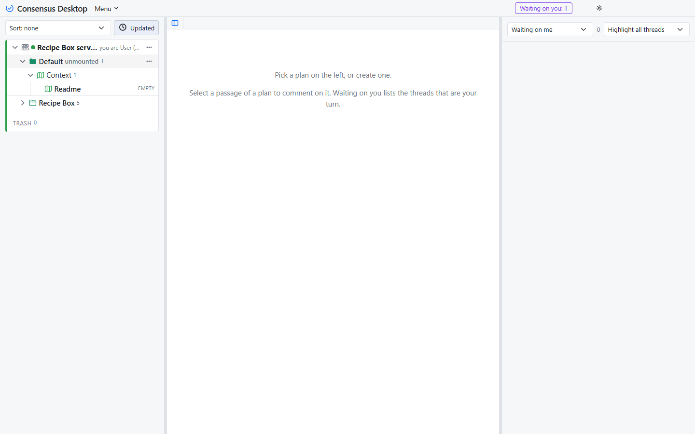
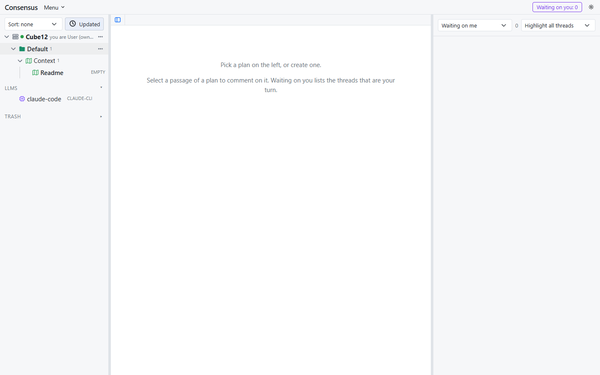

# Getting started

Consensus-AI is a tool you run yourself. It keeps your plans as plain files in a folder, shows them in a window or a browser, and lets an LLM take part through its API. It comes as four applications, which install beside each other and share the page: **Consensus Sidecar** opens one local folder, for you and the agent session beside it; **Consensus Client** opens one project on one Consensus Server; **Consensus Desktop** opens several projects at a time from one or more Servers; and **Consensus Server** opens local folders and serves them to the others, with the users, the LLM connections and tasks, and the projects managed on its page. This page says which to start with, then gets the Desktop and the Server running, from the Windows installers or from the checkout.

The code is public at [github.com/mchiver/consensus-ai](https://github.com/mchiver/consensus-ai). The Windows installers are on the [releases page](https://github.com/mchiver/consensus-ai/releases/latest); everything else starts from the checkout.

Consensus-AI is not [Consensus](https://consensus.app), the research search engine at consensus.app, and has no connection to it. Consensus-AI is a tool for settling a plan with your LLM, thread by thread.

## Which application

- **Your own folder, you and your agent.** [Consensus Sidecar](sidecar.html): one window over one local project folder, no sign-in, no Server; your agent works in the project through its API or MCP. Free.
- **One project on a Server.** [Consensus Client](client.html): one project of one Consensus Server per window, picked in its chooser or named on the command line; the Server signs you in, and any account will do.
- **Several Servers at once.** Consensus Desktop, below: every Server you add is a root of one tree, with one sign-in for all of them, for a Personal license.
- **A server for several people.** [The Server](server.html), below and on its own page: local folders served to the Client and the Desktop, in a window of its own or headless, on this machine or on the network.

## The Desktop

Consensus Desktop is for working in projects that live on one or more Consensus Servers at the same time. You sign in once, add the Servers you work with, and each one is a root of the tree, showing the projects it gives you by your roles. It opens no local folder and has no server of its own: every Server's projects, roles, LLM connections and tasks are set by that Server's Administrator and Managers, and the Desktop configures nothing. On Windows the [installer](#the-installers) is the quickest way in; from the checkout:

```
npm run desktop -- [--config <folder>]
```

**Signing in.** The Desktop shows nothing but the sign-in box until you sign in with your Consensus-AI account, which needs a **Personal** license: signed in with less, the box says so, with the link to the licenses and **Sign out**, and nothing else opens. The same sign-in goes with every call to every Server, and each Server decides, project by project, what you may see and do. The sign-in is kept in the Desktop's own window, so a restart finds you still signed in; **Sign out** is in the window's menu. The sign-in is also written as this machine's signed-in person, so a Server started on the same machine sees it.

**Your Servers.** **Servers…**, in the window's menu or in a Server's own menu in the tree, lists the Servers you added:

- **Add server** takes the Server's address (`https://consensus.example.com`, or `http://127.0.0.1:3500` for the Server on this machine). The Desktop tries it with your sign-in and saves it under the Server's own name; a name you already use gets a number. An address that does not answer, or is already in the list, is refused with the reason.
- **The name** can be changed in place. It is the Server's name in this Desktop only.
- **Remove** takes the Server out of the list and changes nothing on the Server.
- Each Server shows **online**, or **offline** with the reason. An offline Server stays in the list and comes back by itself when it answers again.

With no Servers yet, the popup opens on its own after you sign in. Every Server is a root of the project tree, with its projects beneath it, and the waiting list and the tabs cover all of them. **New window** (Ctrl+N, or the window's menu) opens another window on the same Servers.



**Working in the projects.** Plans, documents, folders, threads, revisions, reports, Export and the look all work as they do everywhere, as far as your role in each project allows. A Server's LLM tasks run on the Server, as you: the button on a plan's heading follows the run (**Answer · Running 0:42**, or **Queued**), a click while it runs opens the run's popup with its output as it comes and **Stop**, a notice names it when it ends, and **My runs**, under the waiting list, holds your own runs on every Server. The Desktop has no Server Settings, no project settings, no New Project, no Mount, no Users, accounts or role folders, no LLM connections or task settings, no LLM page and no LLM Instructions: a Server's Administrator and Managers configure it in [the Server's own window](server.html), in its page in a browser, or in the Client.

**Settings.** The Desktop keeps its settings in `desktop.json` in the config folder (`<your home>/.consensus`, unless `--config` names another), beside the Client's `client.json` and the Server's `consensus.json`: your Servers, the theme and the size, and the view as you left it. A `desktop.json` from before the editions were cut (recent folders, Hosts) is read for its look and view alone.

**An agent beside the Desktop.** The Desktop's window has an address of its own on this machine, `http://127.0.0.1:<port>`, printed when it starts and kept as `page-port` in `desktop.json`. It serves what a Server serves an agent: `/instructions`, composed for the Desktop over the common guide; `/api`, forwarded to the Server whose project is open in the window (the others under `/servers/<name>/api`), with your sign-in added to a request that carries none, so an agent beside the window acts as you, allowed what your roles allow; and `/api/mcp`, the same tools, which the stdio relay reaches with `--server http://127.0.0.1:<port>` and no token. Until you sign in, a request with no token is answered 401 "sign in". The current Server changes as you open a project elsewhere; the instructions tell the agent to read them again when a call answers an unknown project.

## The Client

The Client is the Desktop's narrower sibling: one project on one Server per window, which is the shape for working on one thing with an agent session beside you. Its chooser lists the Servers you connected to, each with the project you opened on it last, and **Connect to Server** takes a Server's address and one of its projects. Its window's own address serves the agent beside it, as the Desktop's does, forwarded to the window's Server as you. [Consensus Client](client.html) has the page.

## The installers

On Windows each application comes packaged, with nothing to install first. From the [latest release](https://github.com/mchiver/consensus-ai/releases/latest):

- `Consensus-Sidecar-Setup-<version>.exe` installs **Consensus Sidecar**, which asks for a folder when it starts.
- `Consensus-Client-Setup-<version>.exe` installs **Consensus Client**.
- `Consensus-Desktop-Setup-<version>.exe` installs **Consensus Desktop**.
- `Consensus-Server-Setup-<version>.exe` installs **Consensus Server**, and adds **Open in Consensus Server** to the file explorer's right-click menu of a folder (and of the empty space inside one), which registers the folder as a project of the Server and shows it in the Server's window.

Run one, pick the folder (the default is under your user profile), and it puts the application in the Start menu and starts it. The Client, the Desktop and the Server read the same config folder, `<user>/.consensus`, as the checkout does, so a checkout and the installed applications share the settings and the signed-in person; the Sidecar keeps its settings with the project. On Windows 11 the Server's folder entry is under "Show more options"; the uninstaller removes it. The installers are not signed yet: Windows SmartScreen warns once ("Windows protected your PC"); More info, then Run anyway, lets it through. A new version is installed over the old one from its own installer; the config folder stays.

## The account and the tiers

One person is signed in on a machine at a time, kept in `~/.consensus/user.json` for the Client and the Server, and a later sign-in replaces them; the Desktop keeps its sign-in in its window. The license the account carries sets the tier, kept for fourteen days without a check and shown in About:

- **Unlicensed** (not signed in): the Sidecar, which needs no account.
- **Registered** (signed in, free): the Client.
- **Personal**: the Desktop, and running the Server on this machine.
- **Professional**: running the Server on the network.

After fourteen days with no check you are signed out, with a line in About, and nothing you saved is locked away. [The licenses](../pricing.html) lists the tiers.

## The Server

The other application is one server for several people: it holds a registry of projects, serves the mounted ones to the signed-in accounts with a role in them, on this machine or on the network, and runs the LLM connections and tasks. It runs with a window of its own, or headless from the checkout or in Docker; the page [The Server](server.html) is about it, and [Sharing a server](sharing.html) about its sign-in, accounts and roles. From the checkout, with Node 22 or later and git:

```
git clone https://github.com/mchiver/consensus-ai.git
cd consensus-ai
npm install
npm run server
```

`npm run server` opens the Server's window; `node bin/consensus-server.js --headless`, or `node bin/consensus.js serve`, runs it with no window and prints its address, its config folder, its settings file and the projects it loaded:

```
Consensus at http://127.0.0.1:3500/ (Scope Local, listening on 127.0.0.1)
closed: the Server waits for its first sign-in: a Personal or Professional license makes the Administrator; the page at http://127.0.0.1:3500/ signs in
config folder C:\Users\you\.consensus
settings written to C:\Users\you\.consensus\consensus.json
project Default at C:\Users\you\.consensus\projects\Default (unmounted)
1 project is unmounted: accounts see mounted projects alone; the Administrator mounts a project in its menu on the Server's page
Server address in C:\Users\you\.consensus\~host.json
no window: this is the headless form; open the address in a browser, or run the Server with its window (consensus-server, or npm run server); Ctrl+C stops the server
```

A new Server is closed until its first sign-in: sign in on its page, in the window or at `http://127.0.0.1:3500/` in a browser, with a Personal or Professional license, and you are its Administrator. You then see the **Default** project with its Context folder and an empty Readme.



Across the top runs the **title bar**: the brand, a **Menu** (About, with the version, the links and a summary of every project's threads; Hotkeys; and, in an application's window, the window's commands), **Waiting on you** with the count of threads that wait on you, **Running** while an LLM run is in progress, and a gear for the look: the theme, the size, the editor and Confirm on close.


The config folder holds the settings and the registry, and the projects that were made with no folder of their own; a project is a folder with a `.consensus` in it (the page [Settings](settings.html) has the layout). The headless program, `bin/consensus.js`, takes these:

| Option | What it does |
| --- | --- |
| `serve` | the Server, headless: every registered project served, the mounted ones to the signed-in accounts; the bare form with no path means the same |
| `<path>`, or `--project <folder>` | one project alone, its sidecar: the folder's project is served and no other, to you with no sign-in, its `.consensus` made when it has none (named after the folder), its address written to the folder; `consensus .` is the folder you are in |
| `mcp <folder>` | the MCP shim over that folder's sidecar, for an agent's configuration |
| `--config <folder>` | the config folder; `.consensus` in your user folder by default (`--data` is its older name) |
| `--port <port>` | the port; the settings' Port, 3500 by default, for the Server (the port in use gives way to a free one, printed); a sidecar's port is hashed from its folder unless given here |
| `--scope none`, `local` or `public` | for this start, in place of the settings' Scope: `local` listens on this machine only, `public` on every interface (with the Administrator's Professional license), `none` starts no server; a sidecar listens on this machine whatever the Scope |
| `--headless` | accepted here and does nothing: this form never has a window |

Listening beyond your own machine is a decision: keep the Scope Local unless the Server is for a team on the network.

## In Docker

The repository holds a `Dockerfile` and a `compose.yaml`. From the checkout:

```
docker build -t consensus:latest .
docker compose up -d
```

The image runs the Server headless with `serve --config /data --scope public --port 3500 --headless`: it listens on port 3500 and keeps its config and data in the `consensus-data` volume. Open its address in a browser and sign in to make yourself its Administrator; set `CONSENSUS_ADMIN` to your email so nobody else can. `docker compose down` stops it; the volume stays. The `compose.yaml` as shipped publishes the port on every IPv4 address of the host, because it is written for a server on a private network; edit it for your own.

## What to do first

1. Open the Readme in the Context folder and write a few lines about what the project is for. Every LLM that works on the project reads it.
2. Make a plan with **New plan** in the project's menu, and write a draft.
3. Select a sentence of the draft and comment on it. That is a thread, and the rest of this guide is about what happens next.
4. Read [Ways of working](ways-of-working.html) for how an LLM takes part: an agent session beside your editor, or a connection the Server runs, and the loop you will use with either.
