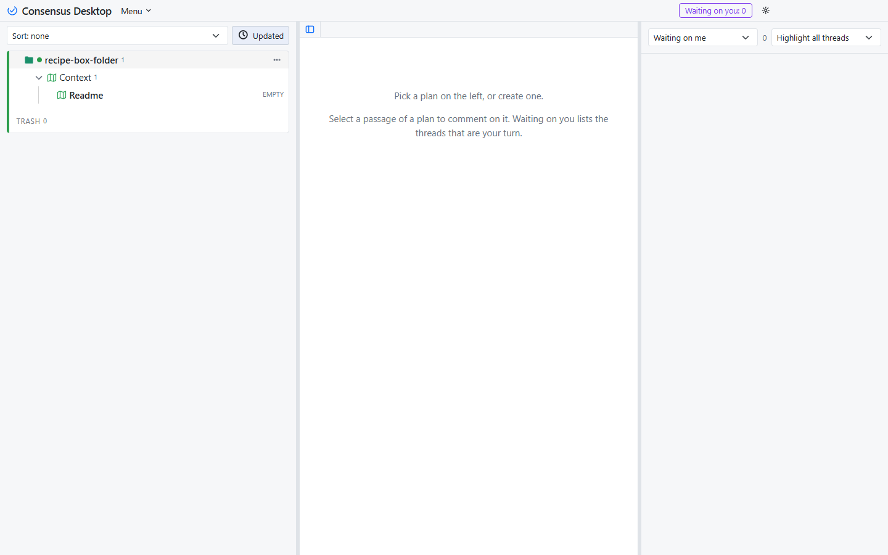
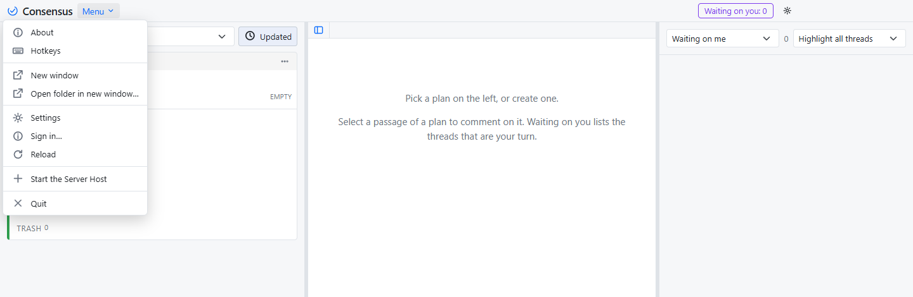

# Getting started

Consensus-AI is a tool you run yourself. It keeps your plans as plain files in a folder, shows them in a window or a browser, and lets an LLM take part through its API. It comes as two applications: **Consensus Desktop**, one project in one window with a server of its own inside, which is where you work on your own folders; and **Consensus Server**, one server for several people, which also manages the users, the LLM connections and tasks, and the projects. This page gets the desktop running first, from the Windows installer or from the checkout, then the Server.

The code is public at [github.com/mchiver/consensus-ai](https://github.com/mchiver/consensus-ai). The Windows installers are on the [releases page](https://github.com/mchiver/consensus-ai/releases/latest); everything else starts from the checkout.

Consensus-AI is not [Consensus](https://consensus.app), the research search engine at consensus.app, and has no connection to it. Consensus-AI is a tool for settling a plan with your LLM, thread by thread.

## The desktop

Consensus Desktop is where you work: one project in one window, with a Consensus server of its own inside. The app opens a folder, as an editor does, makes the folder's `.consensus` when it has none, and shows that project's tree. On Windows the [installer](#the-installers) is the quickest way in; from the checkout:

```
npm run desktop
npm run desktop -- W:\projects\tic-tac-toe
npm run desktop -- --connect cube4
```

With no folder the app opens on the **chooser**: **Recent projects** (Open, or Forget to drop one from the list; the folder stays), **Open folder…**, **New project** (a name and the folder to put it in) and the **Servers** you connected to, each opening in this window. Another project is another window: the menu's **New window** opens a chooser, **Open folder in new window…** and the recent folders start one on a folder, and the app is one process per window, so a folder already open in another window is brought to the front, not opened twice.


The page shows the one project: its tree, open, with the Trash beneath it. The window has no frame of its own: the page's title bar is the window's, the minimize, maximize and close buttons sit over its right end in the palette's colours, and the bar drags the window.



### The sidecar

The server inside the window is the **sidecar**: the API and the MCP of the open project, on this machine alone, for the agent session you keep beside the window. It listens on a port hashed from the folder's path into 3600 to 3699, stepping up while the port is taken, and keeps its address in the folder's `.consensus/~sidecar.json` while the project is open, so an agent finds it without a copy and paste. It needs no sign-in: every request is you.

This is **sidecar mode**: the agent session is the LLM's way in, and the window has no LLM connections, no LLM tasks, no users and no roles of its own; those are a Server's.

Two ways to point an agent at it. **LLM Instructions** in the project's menu opens the instructions page the server serves, with the address first and a **Copy** button: paste the one line into your session ("read the instructions at http://127.0.0.1:36xx/instructions with curl") and it knows the rules, the address and the one project it works in. Or give the agent one MCP entry per project, fixed for good:

```
claude mcp add consensus -- consensus mcp W:\projects\tic-tac-toe
```

`consensus mcp <folder>` reads the sidecar's address from the folder at every message and fills in the project for every tool, so the entry keeps working as the project is closed and opened; while the folder is not open, each request is answered with one message saying so. [Working with an LLM](llm.html) has the rest.

### Connecting to a Server

Signed in, the desktop is also a thin client of a Server: **Connect to Server** on the chooser takes a name and the Server's address, and opens the Server in the window, where you sign in and work on the projects you have a role in, with the Server's LLM tasks. The pair is saved under **Servers** for next time, and `--connect <name>` opens it from the command line. A folder the Server on this machine serves opens through the Server rather than as a sidecar, so one folder never has two writers. [The Server](server.html#the-desktop-and-the-server) has the details.

### The menu, the account and the tiers

The title bar's **Menu** has New window, Open folder in new window and the recent folders, **Settings** (the project's), **Sign in…**, Reload and Quit; Ctrl+N, Ctrl+Shift+O and Ctrl+R do the same, and F11 goes full screen.



The desktop is free to use on your own folders with no account. **Sign in…** signs you in with your Consensus-AI account; one person is signed in on a machine at a time, kept in `~/.consensus/user.json` for both applications, and a later sign-in replaces them. The license the account carries sets the tier, kept for fourteen days without a check and shown in About:

- **Unlicensed** (not signed in): the desktop in sidecar mode.
- **Registered** (signed in, free): connecting the desktop to Servers.
- **Personal**: running the Server on this machine.
- **Professional**: running the Server on the network.

After fourteen days with no check you are signed out, with a line in About, and nothing you saved is locked away. [The licenses](../pricing.html) lists the tiers.

`--config <folder>` names the config folder and `--port` the sidecar's port. The desktop has no headless form: `consensus-server --headless` runs a Server, and `consensus <folder>` one project's server with no window.

## The installers

On Windows each application comes packaged with its server, with nothing to install first. From the [latest release](https://github.com/mchiver/consensus-ai/releases/latest):

- `Consensus-Desktop-Setup-<version>.exe` installs **Consensus Desktop**, and adds **Open in Consensus Desktop** to the file explorer's right-click menu of a folder (and of the empty space inside one), which opens the desktop on that folder's project alone.
- `Consensus-Server-Setup-<version>.exe` installs **Consensus Server**, and adds **Open in Consensus Server**, which registers the folder as a project of the Server and shows it in the Server's window.

Run one, pick the folder (the default is under your user profile), and it puts the application in the Start menu and starts it. Both read the same config folder, `<user>/.consensus`, as the other ways do, so a checkout and the installed applications share the settings and the signed-in person. On Windows 11 the folder entries are under "Show more options"; the uninstaller removes them. The installers are not signed yet: Windows SmartScreen warns once ("Windows protected your PC"); More info, then Run anyway, lets it through. A new version is installed over the old one from its own installer; the config folder stays.

## The Server

The other application is one server for several people: it holds a registry of projects, serves the mounted ones to the signed-in accounts with a role in them, on this machine or on the network, and runs the LLM connections and tasks. It runs with a window of its own, or headless from the checkout or in Docker; the page [The Server](server.html) is about it, and [Sharing a server](sharing.html) about its sign-in, accounts and roles. From the checkout, with Node 22 or later and git:

```
git clone https://github.com/mchiver/consensus-ai.git
cd consensus-ai
npm install
npm run server
```

`npm run server` opens the Server's window; `node bin/consensus-server.js --headless`, or `node bin/consensus.js serve`, runs it with no window and prints its address, its config folder, its settings file and the projects it loaded:

```
Consensus at http://127.0.0.1:3500/ (Scope Local, listening on 127.0.0.1)
closed: the Server waits for its first sign-in: a Personal or Professional license makes the Administrator; the page at http://127.0.0.1:3500/ signs in
config folder C:\Users\you\.consensus
settings written to C:\Users\you\.consensus\consensus.json
project Default at C:\Users\you\.consensus\projects\Default (unmounted)
1 project is unmounted: accounts see mounted projects alone; the Administrator mounts a project in its menu on the Server's page
Server address in C:\Users\you\.consensus\~host.json
no window: this is the headless form; open the address in a browser, or run the Server with its window (consensus-server, or npm run server); Ctrl+C stops the server
```

A new Server is closed until its first sign-in: sign in on its page, in the window or at `http://127.0.0.1:3500/` in a browser, with a Personal or Professional license, and you are its Administrator. You then see the **Default** project with its Context folder and an empty Readme.


Across the top runs the **title bar**: the brand, a **Menu** (About, with the version, the links and a summary of every project's threads; Hotkeys; and, in the desktop, the window's commands), **Waiting on you** with the count of threads that wait on you, **Running** while an LLM run is in progress, and a gear for the look: the theme, the size, the editor and Confirm on close.


The config folder holds the settings and the registry, and the projects that were made with no folder of their own; a project is a folder with a `.consensus` in it (the page [Settings](settings.html) has the layout). The headless program, `bin/consensus.js`, takes these:

| Option | What it does |
| --- | --- |
| `serve` | the Server, headless: every registered project served, the mounted ones to the signed-in accounts; the bare form with no path means the same |
| `<path>`, or `--project <folder>` | one project alone, its sidecar: the folder's project is served and no other, to you with no sign-in, its `.consensus` made when it has none (named after the folder), its address written to the folder; `consensus .` is the folder you are in |
| `mcp <folder>` | the MCP shim over that folder's sidecar, for an agent's configuration |
| `--config <folder>` | the config folder; `.consensus` in your user folder by default (`--data` is its older name) |
| `--port <port>` | the port; the settings' Port, 3500 by default, for the Server (the port in use gives way to a free one, printed); a sidecar's port is hashed from its folder unless given here |
| `--scope none`, `local` or `public` | for this start, in place of the settings' Scope: `local` listens on this machine only, `public` on every interface (with the Administrator's Professional license), `none` starts no server; a sidecar listens on this machine whatever the Scope |
| `--headless` | accepted here and does nothing: this form never has a window |

Listening beyond your own machine is a decision: keep the Scope Local unless the Server is for a team on the network.

## In Docker

The repository holds a `Dockerfile` and a `compose.yaml`. From the checkout:

```
docker build -t consensus:latest .
docker compose up -d
```

The image runs the Server headless with `serve --config /data --scope public --port 3500 --headless`: it listens on port 3500 and keeps its config and data in the `consensus-data` volume. Open its address in a browser and sign in to make yourself its Administrator; set `CONSENSUS_ADMIN` to your email so nobody else can. `docker compose down` stops it; the volume stays. The `compose.yaml` as shipped publishes the port on every IPv4 address of the host, because it is written for a server on a private network; edit it for your own.

## What to do first

1. Open the Readme in the Context folder and write a few lines about what the project is for. Every LLM that works on the project reads it.
2. Make a plan with **New plan** in the project's menu, and write a draft.
3. Select a sentence of the draft and comment on it. That is a thread, and the rest of this guide is about what happens next.
4. Read [Ways of working](ways-of-working.html) for how an LLM takes part: an agent session beside your editor, or a connection the Server runs, and the loop you will use with either.
