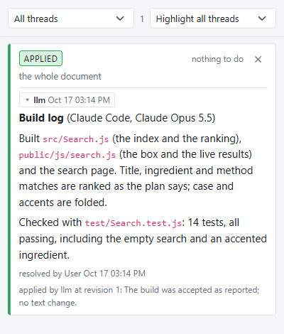
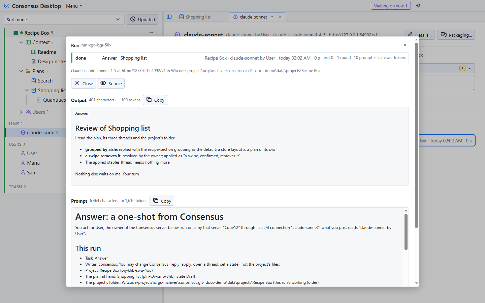

# Working with an LLM

The server reads no code and indexes nothing on its own. Every LLM takes part through the API, acting for you: a coding agent in your repository, or a connection the server runs for you (below). What they all do is the same: read what waits on them, reply, apply what you resolved, draft plans, and build what a finished plan says. [Ways of working](ways-of-working.html) tells it as a story; this page is the reference.

## Who an LLM is

An LLM is never a user. On your own server every request is the owner, you; what an LLM posts is recorded as you, through it, and shown with a **byline**: `Claude-CLI by User`. An agent session says who it is with the header `X-Consensus-Service: <name>` on each request; a connection the server runs needs nothing, the run's token says it. On a shared server a person signs in through Consensus-AI and acts by their role in each project, and their own agent session acts as them on a token from their account's page; see [Sharing a server](sharing.html). There are no participants to manage.

## Giving an LLM the instructions

Your server serves its own guide for LLMs at `/instructions`: what Consensus is, how to call the API, what your words mean ("check consensus", "your turn", "build it"), and the build loop. Its first section, **This server**, holds the API's address as the request reached it and how to say who you are, so an LLM that has read the page has everything it needs to take part. Nothing is installed or configured on the LLM's side. **LLM Instructions** in a project's menu shows that page in a popup, a section naming the project and its Readme put first, with **Copy** for pasting it into an LLM's session by hand; in a browser, **Open** shows the page itself.

How you hand the page over depends on what runs the LLM:

- **An agent session** (Claude Code, or another coding agent with a shell) open on your repository: one line in the chat starts it.

  > Read the instructions at `http://127.0.0.1:3500/instructions` with curl, then load your context.

  Say "with curl": an agent's web-fetch tool often refuses a local or private address, and curl does not. "Load your context" has it read the project's Readme, the tree of plans and what waits on it, and report back in a few lines. From then on, "your turn in Consensus" is the whole prompt. Give the address the agent can reach: `127.0.0.1` for a server on the same machine, the server's name on your network otherwise.

- **A run from the page** (an LLM connection of the server): nothing to do. The packaged prompt starts with the same text, made for the run, with the token the server makes for it (when the task packages the instructions, as the shipped ones do), so the model is briefed on every run.

- **A local model through Ollama**: the server swaps the page for its own tool instructions, because the model works through the server's tools rather than the API, and the token never enters its prompt.

- **Anything else** that can make HTTP requests: fetch the page, give it to the model as its system or first message, and let it call the API as the page says.

The page is the guide the repository keeps at `.guides/build-with-consensus.md`; the server only puts This server at the top. Keep it in mind when the server listens beyond your machine: a Public server without Clerk is a trusted network, where anyone who can reach it acts as the owner.

## Your turn in Consensus

The loop you will use most, with an agent session such as Claude Code open on your repository:

1. You comment on a plan, or resolve threads. The plan's row shows what waits on the llm.
2. You tell the session "your turn in Consensus". It fetches what waits on it, replies to the contested threads, and applies the resolved ones: one revision each, with the outcome recorded on the thread.
3. You read its replies in the threads pane, resolve what you agree with, answer what you do not, and say "your turn" again.

Two words of yours have a fixed meaning for the session. "Check consensus" means report what changed and act on nothing. A message holding a question is answered only; its instructions wait for a message with no question.

## The build loop

When every thread of a plan is resolved and applied, you say "build it". The session sets the plan's state to Working, implements what the plan says, runs the tests, and posts one thread on the whole plan: the **build log**, saying what was built, where, how it was checked, and which model built it.

You accept by resolving the build log; the session applies it, commits the work in your repository, sets the plan to Finished and brings the project's Readme up to date. You send it back by replying instead: it fixes what the reply asks and reports again on the same thread. Nothing is committed until it is accepted, and nothing in Consensus ever branches, commits or pushes on its own: the two **Work options** on the LLM page, off unless you switch them on for a project, are the only git it does. **Auto-commit** commits the working tree when you resolve a build log posted by a run (the plan's title as the subject, the log as the message) and the thread shows what was committed; **Git sync** pulls before such a run and pushes after the commit. Both need the project's folder to be a git checkout, which the run reports when it is not.

## Connections and runs

The server runs an LLM for you, once per click, in a project's folder on its own machine. Its **LLM connections** are kept in its settings and listed once, under the projects of that server in the sidebar; a run through a connection acts for you, and what it posts reads `<connection> by <you>`, such as `claude-cli by User`, on a token the server makes for that run and forgets when it ends, so every reply and every run says which connection posted it and for whom. The owner makes them (**New LLM** in the list's menu), renames them and deletes them; everyone sees them and starts runs.

- An **LLM connection** is a model and how to run it: **Details** names it (letters, digits, dot, dash and colon; a name from before with other characters, such as "Claude CLI" from the desktop's old file, is brought up to date at the next start, the rest turned to dashes), picks the kind, `claude-cli` (a command run without a shell on the server's machine) or `ollama`, the command and its arguments, the model, a timeout, and for Ollama the context window and the most tool rounds a run takes. **Check** tries the connection as entered.
- The **project's folder** is where a run works: the folder the project lives in, with the Include, Exclude and **Commands** of the project's own Settings (one command per line, none by default). A run on a project whose folder is not on the server's machine is refused: an LLM works on the projects of its own machine.

The **LLM page** runs a **task** once, on the project and plan picked. A task is a record of the server's Settings (one row each: a name, a Package of eight switches saying what the prompt holds, a Writes level saying what the run may change, and a prompt), and a project enables the tasks it uses in its own Settings. The package is built from the task's switches: the server's instructions (with the run's token, made when the run starts; the preview says so), the project's Readme, the other Context documents, the plan at hand, the threads waiting on the connection, the project's folder, a box for your own instructions, shown on the page when a task has one and kept per project, and the project's shape (every plan and document with its state and tally, and the last runs) for a task that answers questions about the whole project; **Packaging** on the connection leaves out the documents and threads you uncheck, holds the connection's Session Prompt, and previews any task's package with its size. The shipped five:

- **Answer** reads the plan, the threads waiting on it and the folder, replies and applies. Writes consensus: replies, applies, threads and states, no files.
- **Enhance** makes a plan from a sketch: it reads the plan, the Readme and your instructions from the box, posts a detailed text as one revision and opens a thread for each open question. Answer the threads and press Enhance again, or Answer, until the plan stands. Writes consensus, no folder needed.
- **Work** carries out the plan in the folder, with write, edit and the commands you allowed, and posts the build log. Writes files; the Work options apply to its runs.
- **Explain** answers a question about the project: what it is, who did what and when, what is planned, why a thread was resolved as it was. It lives in the project's Explain tab (Explain in the project's menu; the button on the LLM page opens it): the exchange above, your question below, the answer when the run ends; Clear deletes the conversation's runs. Writes none: it reads through the API and posts nothing.
- **Session** is a run with your own prompt, the connection's Session Prompt, over the Readme and the documents. Writes files.

The same buttons are on a **plan's heading** (plan LLM Tasks, Step 6): the enabled tasks that package the plan, run through the **LLM connection** the project chose in its own Settings. Until it chose one they are greyed out and say so, and a server with no connection shows none. A task with a box asks for your instructions in a popup (the LLM page's box, shared); a line at the bottom says when the run started and when it ended, and the run is logged on the LLM page, where Stop is. The Explain tab asks the same connection.

Writes is the permission: the run's token carries it, so a task with Writes none is refused every write by the server whatever the model tries, and a local model gets the read tools only. Make your own tasks in the Settings popup: a task is a few words of prompt and the switches, and it is not about software unless its prompt is.

Every run is logged, newest first, with who asked for it, and opens in a popup with its prompt and its output rendered or as source. The records live in the config folder, under `runs/`.

A `claude-cli` run hands the package to the command on its standard input; the model works through the API itself, as you through the connection. An `ollama` run keeps the model's tools in the server: the server carries out each call the model makes (over the project's folder, and over itself as you through the connection) and sends the result back, round by round, until the model answers. The token never enters a local model's prompt. Nothing in Consensus ever commits, branches or pushes.
