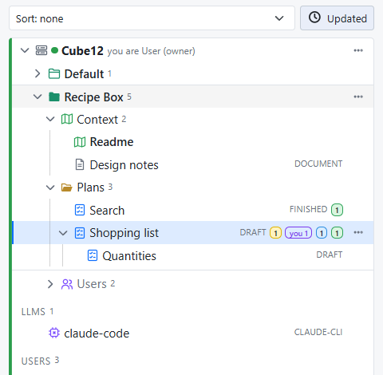
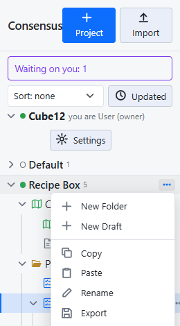

# Projects, plans and documents

Everything in Consensus-AI lives in a **project**. The sidebar on the left is a tree: on a Server, in its window, a browser or the Desktop, the Server's projects; in the Sidecar and the Client the window's one project. Each holds plans, documents and folders.

## The tree

One project is open at a time on each server: opening one closes the others of that server, and opening an item opens its project. A server's row carries a server icon and its live dot; a project's row a folder with a tab, filled when the project is open and outlined otherwise. Each row shows a plan's state, its thread tallies, and a "you" badge when something waits on you.

Above the tree, **Help** has **About** (the version, links to the source and this guide, and a summary of every project: its threads, how many are contested, how many wait on you and how many on the LLMs) and **Hotkeys**, the list of keys (see [Editing and revisions](editing.html)).

Each row's actions are in its menu: the **⋯** at the row's end, or a right-click. Click a folder to make it where new items go; click it again for the project root. Click a folder's chevron to fold it.

## What a project holds

- **Plans** are what you discuss. A plan has text, threads and a **state**: one of the states in the settings, Draft, Plan, Working and Finished by default. Anyone changes the state at any time from the picker in the heading; nothing locks, and a state does not depend on the threads.
- **Documents** are markdown with revisions, but no threads and no state. Documents live only in the project's Context folder.
- **Folders** organize plans, as deep as you like.
- **Subplans**: a plan can hold plans, and only plans. A Subplan is a full plan of its own, with its own threads and state; the tie is organizational. Subplans fold under their parent, and move, copy and go to the trash with it.

## The Context folder

Every project has one, first in its tree. It holds the project's **Readme**, a short account of what the project is and what has been decided, for everyone who works on it, and any other document. An LLM reads the folder's documents for the project's background, so the Readme is the first thing to write.

The folder holds documents only. **New document** in the project's menu, or the folder's, puts one there. Neither the folder nor the Readme is renamed, moved, copied or deleted; the other documents are items like any other.

## Making things

- **New Project** in a server row's menu (the ⋯ at its end, always shown, or a right-click) makes a new project on that server; **Import** and **Settings** (the Administrator's and the Managers') are there too; the row has no other button. With a folder picker (the Server's window) it asks for a folder as well (Browse, or leave it empty for one under the config folder): the project lives in that folder's `.consensus`, and a folder that holds a project already is opened as it is, under its own name.
- **New plan**, **New folder** and **New document** in a project's menu; New plan and New folder in a folder's menu too, which create in it.
- **New Subplan** in a plan's menu, or **New subplan** in the heading of a plan with none yet. From a thread being written or replied to, **Start a new Subplan** starts one with the anchored passage and the thread so far quoted, and the thread gets a reply linking to it. Selected text can start one too: the Subplan starts with that text, and the parent is not changed.

The **Default** project is there from the first start; ad-hoc items live there. Any empty project can be deleted except the last one.

## A project's own settings

**Project settings…** in a project's menu, for its Owners, the Administrator and the Managers, opens its own settings: its **Name**; its lists, one per line each: its **States** (the server's list is only the default for a new project; a state still used by one of its plans cannot be removed), and the **Include**, **Exclude** and **Commands** an LLM working in its folder goes by; its Work options **Git sync** and **Auto-commit**; then, on a Server, the tasks it enables and its **LLM connection** (plan LLM Tasks, Step 6), the one the task buttons on its plans' headings and its Explain tab run through (none chosen, those buttons wait and say so). The state picker and the menu's "New …" follow the project's States. All of it is kept in the project's `project.json`, but for the tasks and the connection, which are the Server's and kept on the project's entry in its `consensus.json`.

In the Sidecar, **Settings** in the title bar's Menu opens the same popup for the window's project. It has no connection or tasks (the Sidecar has none) and holds the project's **look** instead, saved to its `project.json` (see [Settings and themes](settings.html#the-look)). On a Server the look is the Server's and is never part of a project's settings.

## Archive

**Archive** in a plan's menu moves it, with its Subplans, out of the tree into the project's **Archive** folder, shown folded at the bottom of the project. An archived plan opens and reads as it was, with every thread and revision, but takes no edit, comment, state or reply until **Restore** in its menu puts it back at the project's root. On disk it moves to the project's `archive/` folder.

## Moving, copying and deleting

Everything reorders by drag and drop. Drop an item on the top or bottom edge of a row to put it before or after that row, on the middle of a folder to move it inside, on the middle of a plan to make it a Subplan, or on a project's heading to move it to that project's root. Drop a project's heading on another's to reorder the projects.

**Rename** is in the menu; for a plan or document only its title changes. **Copy** (the menu, or Ctrl+C on the open item) puts the item's export, the same JSON a project's Export makes, on the clipboard, and **Paste** (in a project's or folder's menu, or Ctrl+V into the open project) imports what the clipboard holds there, every id new: a plan with its text, threads, revisions and Subplans, a folder with its whole contents, or a project, which comes in as a folder named after it (its Readme and Context folder stay out). The clipboard is the system's, so an item pastes into another project, into the app connected to another server, or into a file; a Template project on any server is one use. **Export** in the menu shows the same JSON, to copy or download.

A row's menu reads, for a project: New Folder, New Draft, Copy, Paste, Rename, Export, Settings, LLM Instructions, Delete; for a folder the same, creating in it; for the Context folder: New Document, Paste; for a plan: New Subplan, New Comment, Copy, Rename, Export, Delete; for a document: Copy, Rename, Export, Delete. "New Draft" is named after the first of the project's states. Under the projects, the **LLMs** list has the server's LLM connections, with Open, Rename and Delete in a row's menu and New LLM in the list's (the owner's); see [Working with an LLM](llm.html).

**Delete** is in the menu only, confirmed on the row. A plan or document goes to the **Trash** at the bottom of the sidebar, whose heading counts what is there; **Empty Trash** in its menu removes it all for good, after a confirmation under the heading. A project or folder is deleted only when it is empty.

Every item belongs to exactly one project. To reuse one elsewhere, copy it and paste it there.
