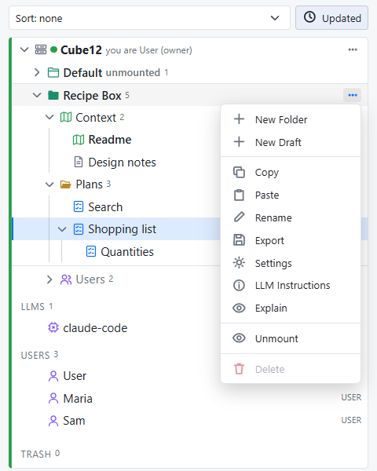

# The Server

Consensus-AI comes as two applications. **Consensus Desktop** opens one project folder in one window, with the project's own server inside, the sidecar, for you and your agent on this machine; [Getting started](getting-started.html) is about it. **Consensus Server** is the other: one server that holds a registry of projects and serves them to people, each signed in and each with a role, on this machine or on the network. It is everything the desktop is, plus the management of the machine's resources: the users, the LLM connections and tasks, the projects and their permissions. This page is the Server: how it starts, what it serves, who manages what on it, and how the desktop works with it. [Sharing a server](sharing.html) follows with the sign-in, the roles and the tokens.

## Starting it

On Windows, run `Consensus-Server-Setup-<version>.exe` from the [latest release](https://github.com/mchiver/consensus-ai/releases/latest); it puts **Consensus Server** in the Start menu. From the checkout:

```
npm run server
node bin/consensus-server.js [--open <folder>] [--config <folder>] [--port 3500] [--scope local|public] [--headless]
```

The Server reads the config folder (`.consensus` in your user folder, or the one `--config` names), listens as its Scope says, and serves every project its registry lists. Its window shows the Server's own page: every registered project as a tree of its own in the one sidebar, with the LLM connections, the Users fold and the Trash beneath them. One Server runs per machine: a second launch hands its arguments to the first and ends. Closing the window does not stop the Server: its icon in the tray brings the window back, shows the address, and its **Quit** ends the Server. While it runs it writes its address to `<config>/~host.json`, so the desktop on the same machine finds it.

`--headless` runs the Server with no window, which is what the Docker image and `npm start` do; `consensus serve` is the same for a plain node install. It prints where it is and whether it is open:

```
Consensus at http://127.0.0.1:3500/ (Scope Local, listening on 127.0.0.1)
closed: the Server waits for its first sign-in: a Personal or Professional license makes the Administrator; the page at http://127.0.0.1:3500/ signs in
config folder C:\Users\you\.consensus
settings from C:\Users\you\.consensus\consensus.json
project Recipe Box at C:\Users\you\projects\recipe-box (unmounted)
1 project is unmounted: accounts see mounted projects alone; the Administrator mounts a project in its menu on the Server's page
Server address in C:\Users\you\.consensus\~host.json
```

## The first sign-in

A new Server is closed: it serves its page and the sign-in, and refuses everything else with the reason. The first person to sign in with a **Personal** or **Professional** license becomes its **Administrator**, and the Server opens. In the window, sign in from the page; a headless Server is opened from a browser at its address. When the environment variable `CONSENSUS_ADMIN` names an email, only that person can make the first sign-in, which keeps a Docker server on the network from being claimed by whoever reaches it first.

The Server runs under the Administrator's license: Personal lets it listen on this machine, Professional on the network too (Scope Public). Its later starts check the Administrator again: in the window, the person signed in on the machine; headless, the license the Administrator's last sign-in showed.

From then on the Server tells people apart by their sign-in, Local or Public alike: every request is a signed-in person, a token, or refused. See [Sharing a server](sharing.html).

## The registry and mounting

The Server's settings file, `consensus.json`, holds the registry: the project folders it knows, in display order, each with a **Mounted** switch.

A project registered on the Server, with **New project** or **Add folder**, starts unmounted: read and written by the Administrator and the Managers alone, marked "unmounted" in its row, and not there for anyone else, in the lists, the tree and the API. **Mount** in the project's menu opens it to the accounts that hold a role in it; **Unmount** takes it back without touching the roles.



**Open in Consensus Server**, which the Server's installer adds to a folder's right-click menu in the file explorer (and `--open <folder>` on the command line), registers the folder as a project of the Server, or finds it when it is registered already, and shows it in the Server's window.

## Who manages what

The users, the roles, the LLM connections and the tasks are managed on the Server's page, by the Administrator and the Managers, as [Sharing a server](sharing.html) and [Working with an LLM](llm.html) describe: they make accounts and place anyone in a project's roles, define the connections and the tasks, and mount the projects; a project's Owners place people in its roles. Only the Administrator makes Managers. The LLM tasks always run on the Server.

## The desktop and the Server

The desktop starts no Server: the Server is an application of its own. A desktop window reaches one in two ways, both needing a sign-in in the desktop (a free Registered account is enough):

- **Connect to Server** on the desktop's chooser: a name and the address, then **Try**. A Server answers that it asks for a sign-in, and **Connect** opens it in the window, where you sign in and see the projects you may; a saved entry with a project opens on it. The page works on the Server and writes nothing on your machine, and its tasks are the Server's.
- **Open folder**, or **Open in Consensus Desktop**, on a folder the Server's registry lists as mounted, while the Server runs, connects the window to the Server's project instead of opening the folder as a sidecar, so the Server stays the one writer of that folder. When the Server is not running the folder opens as a sidecar.

An agent session beside a Server project takes its token from the project's **LLM Instructions**, or, wired through MCP, from `CONSENSUS_TOKEN`: `node bin/mcp.js --server http://<server>:<port> --service <your name>`. The sidecar's fixed entry, `consensus mcp <folder>`, is the desktop's own; see [Working with an LLM](llm.html#through-mcp).
