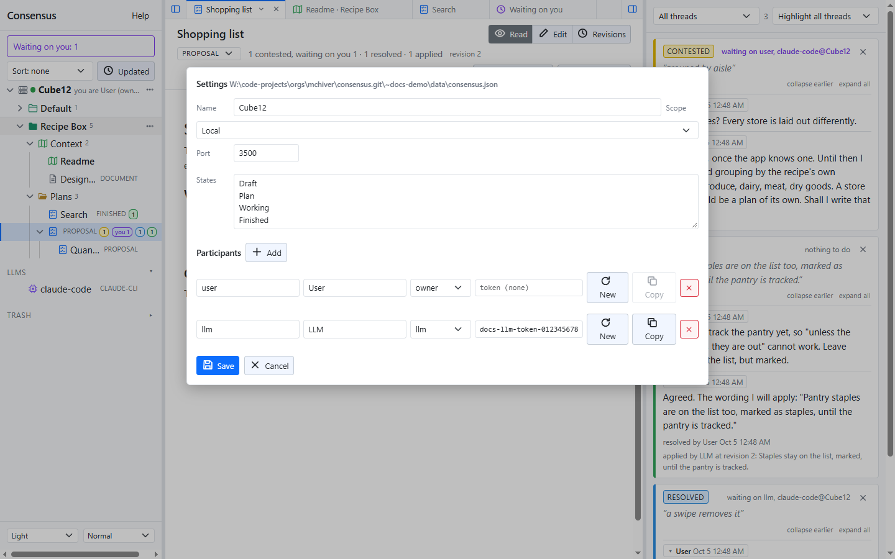
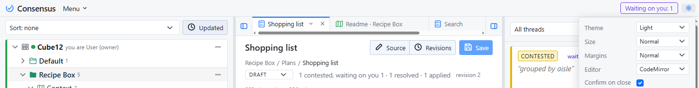

# Settings and themes

**Settings** in a server row's menu (the ⋯ at the row's end) opens that server's settings in a popup, for the owner. The theme, the size, the editor and Confirm on close are behind the gear at the right end of the title bar, for everyone.



## Name, scope and port

The server's name, shown to its clients; its Scope, which says whether it listens and for whom: **Local** on this machine only, **Public** on every interface, **None** not at all (the desktop then is a client of other servers only); and its port. Scope and Port take effect at the next start, and the popup says so.

A line beneath them says what the Scope comes to. Local is this machine only, and a request is the owner. Public signs people in through Consensus-AI: a request with no session and no token is refused, and everyone acts by their role in each project. Public is offered to a sign-in with a **Host license** alone (plan Clerk, Step 5): on a Local server the **Sign in** button beside the line signs you in with your Consensus-AI account, and once the page holds a Host license the Public choice is enabled; the server refuses the save otherwise. A server started Public from its file or from the command line listens and admits licensed sign-ins alone.

The license belongs to a person, not to a server: a **Host** license runs a Public server and is its Administrator; a **User** license is an Owner or a Member in projects; a Watcher needs an account and no license. A site license is an organization in Consensus-AI carrying the license for its members, who join through its invitation email. Free is the Local server: no sign-in, your typed name, the tokens you mint for agents and services, as many installations as you like.

## States

The states a plan's state is picked from, one per line: Draft, Plan, Working and Finished by default. A new plan starts in the first. A state still used by a plan cannot be removed. The first state was called Proposal before; a server whose list still names Proposal and not Draft renames it once at its next start, in the settings and in every plan in that state.

## Clerk

People sign in through Consensus-AI's own Clerk instance, whose publishable key is built in, so a Public server needs nothing here (plan Clerk, Step 5). The section is an override and the Administrator's email: a publishable key of another Clerk instance of your own in place of ours; the secret key and the webhook signing secret, which Consensus-AI's own servers use (the secret key fetches a person from Clerk when their token lacks their email; the webhook at `/api/clerk/webhook` keeps the registry following user and membership events) and a customer's server never needs; and the **Admin email**, the one Administrator of this server, by the email they sign in with. Left empty, the first person to sign in with a Host license becomes the Administrator and their email is written here; a Docker server may name one with the environment variable `CONSENSUS_ADMIN`. A key given is checked for its prefix (`pk_`, `sk_`, `whsec_`) and the email for its shape; an empty section is not written. Saved, the section counts at once. A person's first sign-in writes their account to the registry (matched by email to one you made by hand, or new with no role), with the plan their license shows; a person whose roles need a plan their license lacks is told so in the sign-in box, with the pricing page, and signs out. On a Local server a sign-in is the owner's, for going Public.

## Owner

The owner is the one account of a Local server: a bare request is the owner (plan User Management; on a Public server people sign in instead, see above). Since User Management Step 3 the server keeps a registry beside the settings, `Users.json`, with the owner's record and, on a shared server, the accounts the Administrator makes on the sidebar's Users fold; each account's page holds its tokens (a request carrying one is that account) and a project's Users folder holds its role folders, Owners, Members, Service and Watchers. Its **name** is what threads and revisions record, kept as it is so the records of before still match; **Shown as** is how the page shows it, and anything done through a service or an LLM connection carries a byline, `<service> by <shown as>`, such as `Claude-CLI by User`. There are no participants and no tokens to manage: an agent session names itself with a header, and a run gets a token the server makes and forgets.

## Tasks

What the LLM page's buttons ask (plan LLM Tasks): one row per task, in the order of the buttons (Add, Remove, up and down). A task has a **Name** (what the button says and the run record carries), a **Package** of eight switches (what the run's prompt holds: the server's instructions, the project's Readme, the other Context documents, the plan at hand, the threads waiting on the connection, the project's folder as the run's working folder, Project, the project's shape for a task about the whole project, and Box, a text box on the LLM page for your own instructions), a **Writes** level (**none**: the run reads only and the server refuses every write; **consensus**: replies, applies, threads and states, no files; **files**: the project's files and its commands too) and a **Prompt** (the task's instructions; empty, the connection's Session Prompt is the task; Reset gives a shipped task its prompt back). Consensus ships Answer, Enhance, Work, Explain and Session; a shipped task added by a later version is added to your list once, at its place, and stays removed if you remove it. A project enables the tasks it uses in its own Settings, all by default; see [Working with an LLM](llm.html).

Saving writes these fields and applies them at once, Scope and Port excepted. The server's own checks apply, and nothing is saved while there are problems; the popup lists them.

## The settings file

The settings are `consensus.json` in the config folder, written at first start:

```
{
	"Name": "cube4",
	"Port": 3500,
	"Scope": "Local",
	"States": [ "Draft", "Plan", "Working", "Finished" ],
	"Owner": { "Name": "user", "Display": "User" }
}
```

An optional `Clerk` section holds the four fields above, and `Tasks` the list of the section above, each `{ Id, Name, Package, Writes, Prompt }`. The server's LLM connections are in the same file (`Llms`, kept through the page's LLM list; see [Working with an LLM](llm.html)), and so are the desktop's own fields (`Servers`, `Theme`, `Scale`, `Remembered`); the popup touches neither. The file is read once at start, so an edit by hand needs a restart; the popup does not. A file from before is brought up to date at the next start: a `Host` becomes a Scope (a local address Local, any other Public), a missing Name becomes the machine's, a `Participants` list becomes the Owner (its other entries dropped), the connections lose their tokens, and the Tasks list is made, a connection's own Review and Build prompts becoming the Answer and Work tasks' and its Checks dropped.

## Theme and size

The gear at the right end of the title bar opens the look: the theme (light, dark, the system's, or a palette from Sepia and Paper to Nord and Midnight), three sizes, the editor, CodeMirror or Monaco, and Confirm on close (see [Editing](editing.html)). They are kept in the browser, not in the settings; the desktop keeps one theme for its window, whatever the servers it shows, and its window buttons follow the palette.



## The config folder and the project folders

The config folder, `.consensus` in your user folder by default or the one `--config` names, holds the settings, `consensus.json`, whose `Projects` list the project folders in display order (a folder opened from the command line goes to the top). Each project is a folder of its own, a repository as a rule, with a `.consensus` sub-folder that is the project; a project made with no folder named goes under `projects/` in the config folder. Everything is plain files:

```
<config>/Users.json                        the accounts of the server (User Management Step 3): the owner, the users and the Service accounts, each with its hashed tokens
<project>/.consensus/project.json          the project: its name and tree, its Archive, its States, Include, Exclude and Commands, its Tasks, its Work options GitSync and AutoCommit, and its Roles (the four role folders, account ids)
<project>/.consensus/content/<id>/content.md    a plan's or document's text
<project>/.consensus/content/<id>/content.json  its record
<project>/.consensus/content/<id>/threads.json  its threads
<project>/.consensus/content/<id>/revisions/    every revision's text and record
<project>/.consensus/archive/<id>/         an archived plan, moved whole
<project>/.consensus/trash/<id>/           a deleted item, moved whole
```

The `.consensus` folder is meant to go into source control with the repository, so the plans and threads travel with the source; nothing secret is written to it. Back a project up by copying its folder. A config folder from before project folders (every project in one data folder) is migrated at the next start, each project into a folder of its own under `projects/`; the console says what moved. A listed folder that is missing, or on a drive not mounted, is skipped with a line and kept in the list; the desktop's connect screen names it.
