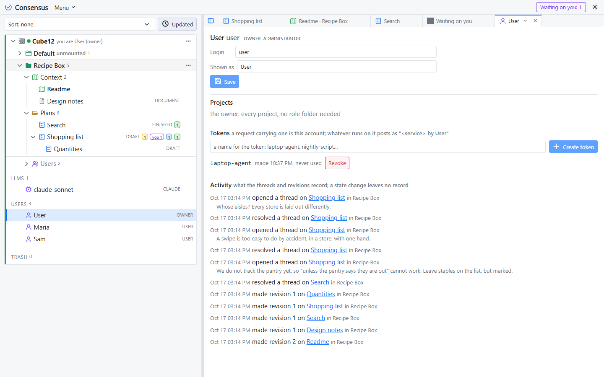
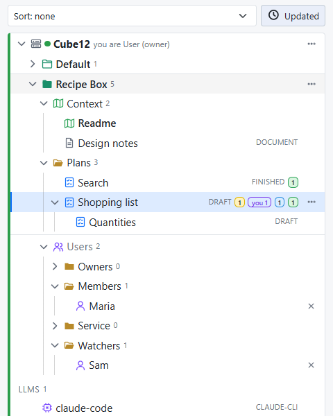

# Sharing a server

A Consensus-AI server on your own machine is yours alone: every request is the owner, and nobody signs in. A server for a team listens beyond the machine, signs people in through Consensus-AI, and gives each of them a role in each project. This page is the order you meet it in: going Public, the Administrator, the accounts, the roles, the tokens, and what each role sees. [Settings and themes](settings.html) has the settings themselves.

## Going Public

A server listens for a team when its **Scope** is Public. Public is offered to a person holding a **Host license**: in the Settings popup, press **Sign in** beneath the Scope, sign in with your Consensus-AI account, and once the page holds a Host license the Public choice is enabled; save, and the server listens on every interface from its next start. A server started Public from its file or from the command line, the Docker image among them, listens at once and admits licensed sign-ins alone: nothing can be done on it until a person with a Host license signs in.

On a Public server a request with no session and no token is refused. The page shows Consensus-AI's sign-in box, and a person who has signed in is who they are everywhere on the server, in the browser and in the desktop alike. Consensus keeps no password: Consensus-AI's sign-in identifies people, and Consensus holds the roles.

## The Administrator

Every Public server has one Administrator: the first person to sign in with a Host license, or the one a Docker server names with the environment variable `CONSENSUS_ADMIN`. The Administrator alone writes the server's settings, makes and deletes accounts, mints a Service account's tokens, defines the LLM tasks and connections, makes and deletes projects, and may place anyone in any project's roles. Inside a project the Administrator otherwise acts by the role folder they are in, like anyone.

## Accounts

The server keeps a registry of its accounts, shown as the **Users** fold at the bottom of the server's tree, which every signed-in person sees. An account is a **user**, a person, or a **Service account**, a system that is nobody's in particular: a bot, a scheduled job, a system the team shares.

A person's account is written the first time they sign in, from their sign-in: their email, their names, and the license their account carries. The Administrator may make the record ahead of time with **New user** in the fold's menu (a login, a display name and the email), so the person can be placed in a project before they ever sign in; the record is completed by their first sign-in, matched by email. **New Service account** makes the other kind, with a name. A record is removed by the Administrator from the account's page, which takes it out of every role folder and revokes its tokens.

Clicking an account opens its page: its details, the projects it has a role in, its tokens, and its activity on the server, newest first. A person sees their own page; the Administrator sees everyone's.

## Roles

A role is what an account may see and do in one project. Every project has a fixed **Users** folder, last in the project with the people icon, holding exactly four folders: **Owners**, **Members**, **Service** and **Watchers**. An account is in one of them at most. The Administrator, or an Owner of the project, drags an account from the server's Users fold into a folder to give it that role, between folders to change it, and presses the × beside it to take it out of the project.

| Role | May | License |
|---|---|---|
| Owner | everything in the project: read, write, comment and reply, resolve any thread, set the plan states, create, rename, move, archive and export, manage the Users folder, enable the server's tasks for the project, press any task | User |
| Member | read and write: edit, create, comment and reply, resolve the threads they started, apply any resolved thread, press the tasks that write to Consensus or to files | User |
| Service | read and write the project through the API as a Member does, resolve nothing; press no task, so no run is ever started under it | none (a token) |
| Watcher | read the project and its threads; press the tasks that read only, Explain among them | none |

The license is the person's, not the server's: a **User** license is needed to be an Owner or a Member, and the server says so when someone is dragged into those folders without one. A Watcher needs an account and nothing more. A site license is an organization in Consensus-AI whose members carry it.

Which task a role may press is read from the task's **Writes** level, never from its name: a task that writes nothing is every role's, a task that writes to Consensus or to files is Owners' and Members', and a Service account presses none. A task you make next year is governed the same way the day you make it.

## Tokens

A token is the credential for anything that is not a browser: an agent session beside your editor, a script, a desktop window on another machine, a service you run. Every account mints its own on its page: **Create token** with a name, the value shown once, then listed with its last use, and **Revoke** beside it. A request carrying the token (`Authorization: Bearer <token>`) is that account, in every project the account has a role in, and every record of what it did names the account, the token and the service that declared itself.

For your own agent session on a shared server, the one line to paste becomes two facts: the instructions page, and your token. Mint one on your page, then:

> Read the instructions at `http://team-server:3500/instructions` with curl, and send `Authorization: Bearer <your token>` with every request.

The agent then acts as you, allowed what your role allows, and what it posts reads `<agent> by <you>`. A Service account's tokens are minted by the Administrator on its page, for the systems that are nobody's.

## What each role sees

A project is shown to those with a role in it, and to the Administrator. The server's Users fold is shown to every signed-in account; an account's page to that account and to the Administrator. A person with no role in any project sees the Users fold alone, until an Owner or the Administrator places them. A request outside what a role allows is refused with the reason in plain words, in the page and over the API alike: "a Watcher reads only", "no role in this project".
