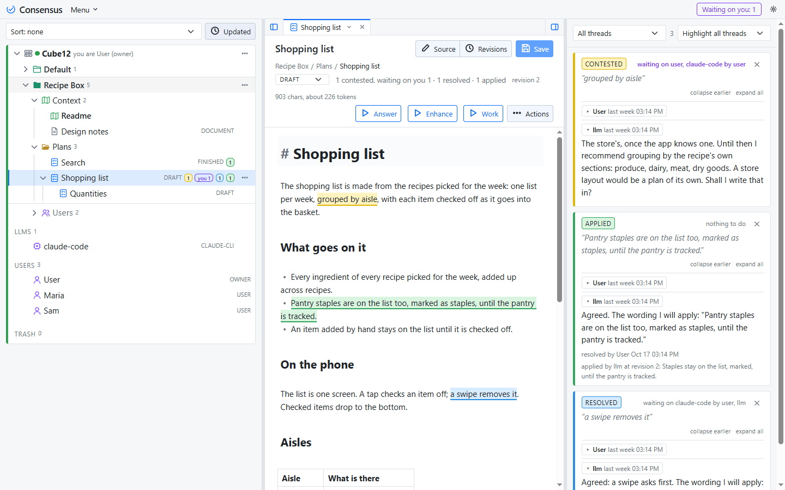
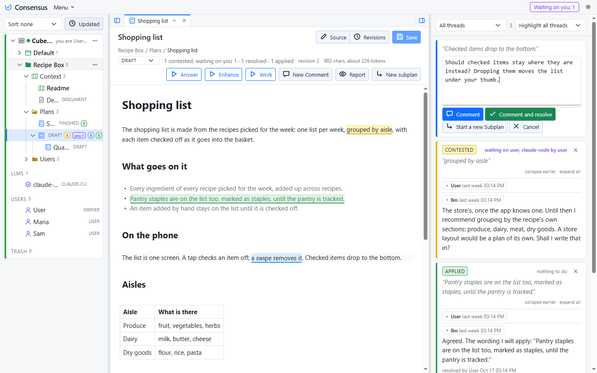
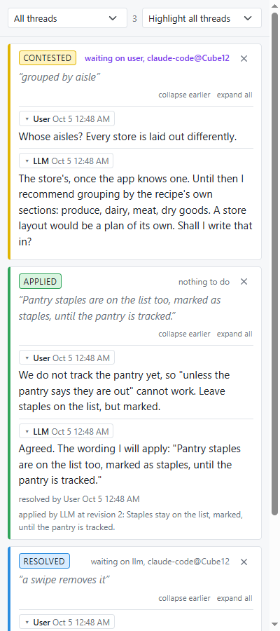
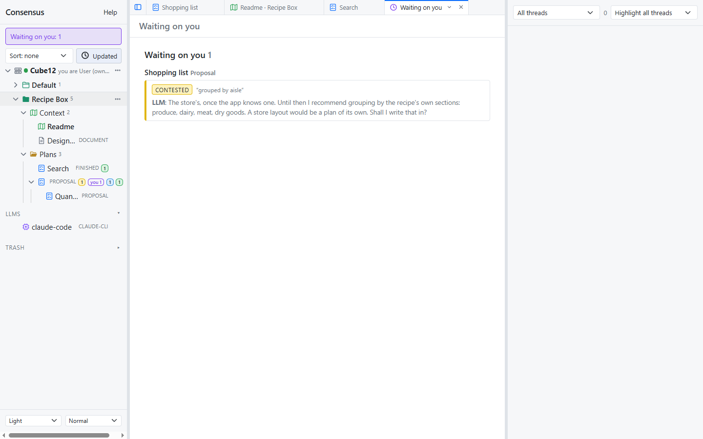

# Threads

A thread is a comment on a plan, and the way a plan is settled. You comment on a passage, the LLM replies, you resolve, and the LLM applies the outcome to the text. The plan is done when every thread is applied. On your own server you are the only person; on a shared one the same rules hold among many, with the project's roles saying who may do what (below, and in [Sharing](sharing.html)).

## Starting one

Select text in the plan, click **Comment**, write and post. The thread is **anchored** to the words you selected, which are highlighted in the text. A comment with nothing selected is on the whole document.

## The three states

Every thread is in one of three states, and the colour of its passage says which.

- **Contested** (yellow): under discussion. The thread waits on everyone except the one who replied last, so a reply hands it over.
- **Resolved** (blue): its starter or an Owner has settled it, and it waits for the LLM to apply the outcome. It never looks finished before the text shows it.
- **Applied** (green): the LLM changed the text, or confirmed that nothing had to change, and recorded who, when, the revision and the outcome.

Any reply to a resolved or applied thread **reopens** it (orange): contested again, marked reopened. Reopening never reverts a change already applied; resolving it again makes it wait to be applied again.

## Resolving

A thread is resolved by the one who started it, or by an Owner of the project: the one who asked knows when it is answered, and an Owner can close any thread so that a starter who has gone quiet does not hold the plan. There is no vote. The one **Resolve** button works in one of two ways:

- With a reply typed in the box, Resolve posts it and resolves the thread with it. Your reply is the outcome the LLM applies, read as the answer to the question before it.
- With nothing typed, Resolve accepts the outcome, or the recommendation, in the last reply.

The selected thread's header has two tools at its right: **Re-anchor** (the target), which puts the thread on a passage you select, and **Start a new Subplan** (on a plan), which replies with a link to a new Subplan that starts from the thread.

On a resolved or applied thread the Reply button reads **Reply and Contest**, in the contested colour: it posts your reply and reopens the thread, which stays open and contested.

Resolving means agreeing with how the thread was deliberated and decided, not with any one line in it: the last reply states what goes in.

## Who does what in a team

On a shared server the people of a project are its **Owners**, **Members**, **Service** accounts and **Watchers** (see [Sharing](sharing.html)); the LLM is never one of them, it acts for the person who pressed the button, shown as the byline. The rules among them:

- **Anyone starts a thread, anyone comments, anyone presses a task**, within their role: a Watcher reads and presses the read-only tasks only; a Service account writes but presses none. There is no turn order among people: the waiting list says whose attention is wanted, it does not forbid.
- **Resolve**: the thread's starter, or an Owner. A Member resolves the threads they started.
- **Apply**: anyone with write access, an Owner, a Member or a Service account, in person or through the LLM acting for them. Usually the LLM does it, on your turn or on Answer.
- **The plan's State** is an Owner's: Draft to Plan is the Owner's acceptance of the text the threads worked out, Plan to Working the word to build, Working to Finished the acceptance of the build. Members move the text through their threads; an Owner signs off once, on the document, not on every thread. The picker is disabled for anyone else.
- **One run per plan at a time**, and one per connection: a press while either has a run on waits its turn, told so, and starts when both are free. Runs on other plans through other connections go together.
- **Delete**: an Owner, any thread.

## Whose turn

A thread waits on its parties: while it is contested, the one who started it, the project's Owners, everyone who has replied in it and the LLM, minus whoever spoke last, so a Reply hands it over and a person who has not joined in is not waited on. Once resolved it waits on the LLM alone, to apply it: a thread you resolve is off your list, and the plan's "resolved" count says it is still to be applied. An applied thread waits on nobody.

**Waiting on you** in the title bar counts every thread waiting on you, across projects and servers, and opens the Waiting tab; beside it, while an LLM run is in progress on any server, **Running** counts the runs and opens the first one's LLM page. The threads pane filters by state and by whose turn it is, and highlights every thread's passage in the text or the open ones' only (the two pickers stay at the top while the list scrolls); both choices are the page's, the same in every item; the filter is remembered in the browser, the highlight is part of the look (see [Settings and themes](settings.html#the-look)). A plan's row shows a "you" badge with the count. Clicking an anchored passage selects its thread, and clicking a thread's quoted words in the pane scrolls the text to its passage and flashes it; the selected thread stays listed whatever the filter, until another is picked or the selection is cleared with Escape or a click in the text off any highlight. After your own reply or resolve the selection passes to the next thread in the pane (or the previous one, when it was the last), so you can work down the list.

## Anchors that follow the text

An anchor holds to the visible words, not the markdown, so bold and links do not break it. After every change to the text each anchor is found again: one whose words changed a little follows them; one that cannot be found is **detached**, shown first in the pane, and can be re-anchored by selecting text.

## Deleting

An Owner deletes a thread with the **×** on its first line. A revision that applied a deleted thread keeps its text and shows "(deleted thread)".
