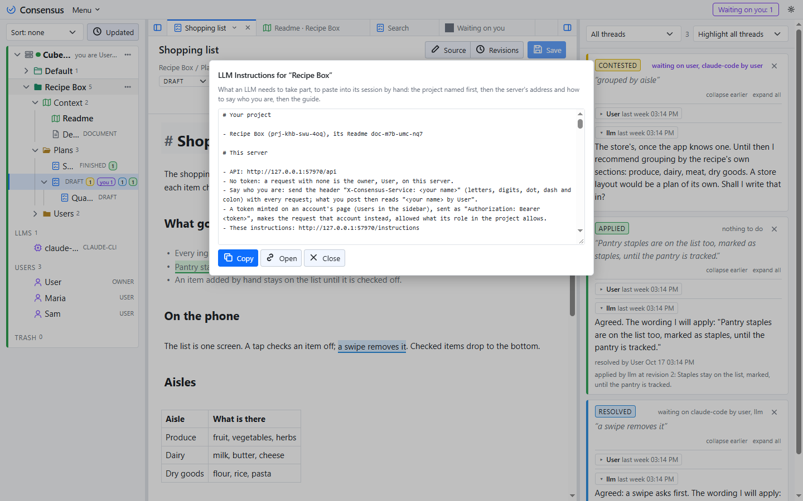
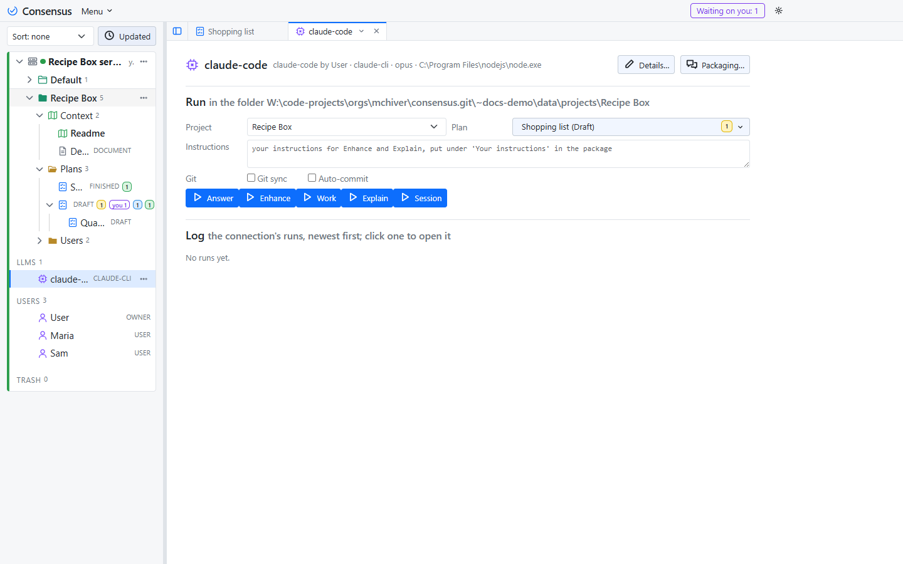
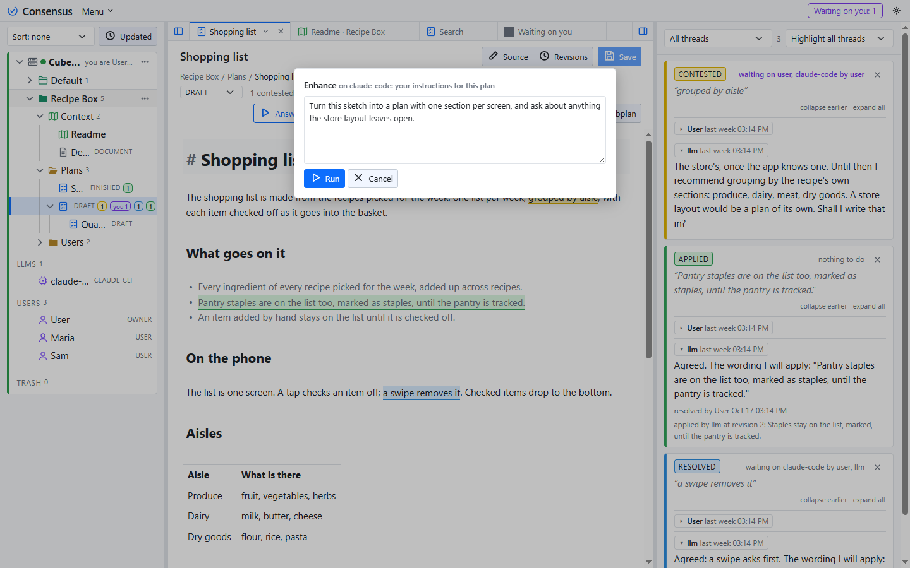
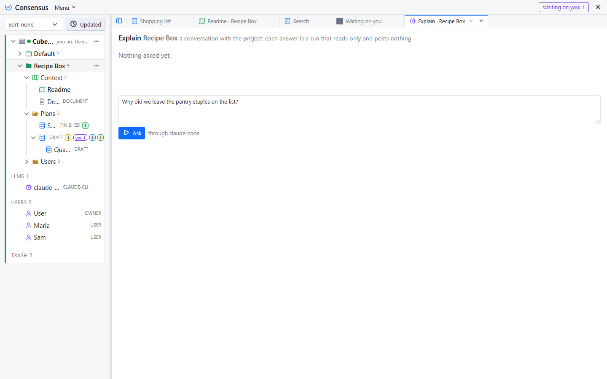
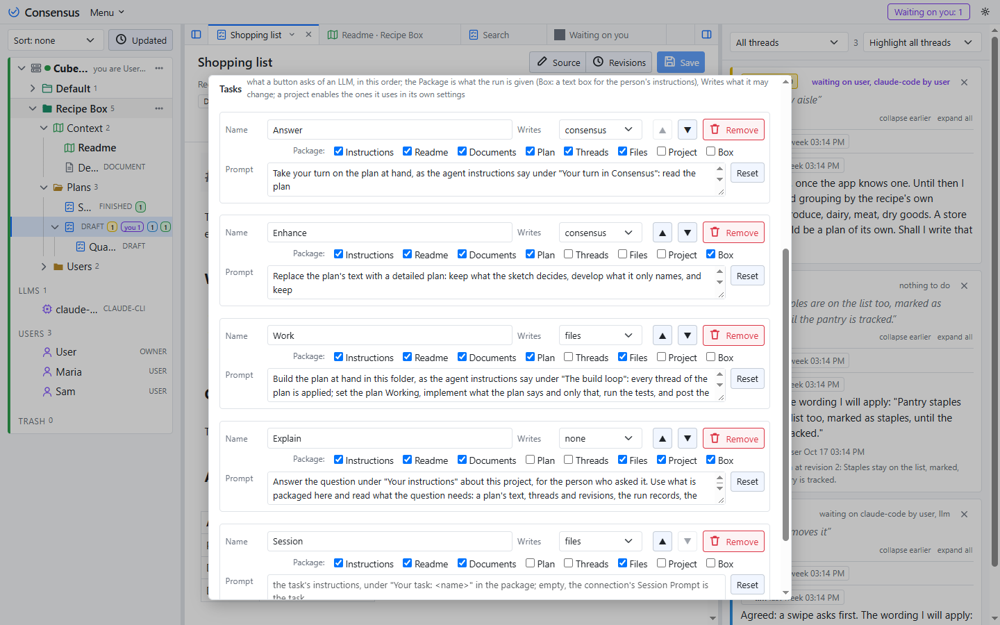

# Ways of working

Consensus-AI is a place where you and an LLM settle a plan, thread by thread, and then have it carried out. The LLM can take part in two ways, and you will likely use both: an **agent session** open beside your editor, and a **connection** your server runs when you press a button. This page tells how each goes, and the loop you will use with either; [Working with an LLM](llm.html) is the reference behind it.

## The agent session

An agent session is a coding agent such as Claude Code, open in a terminal on your repository. It needs one thing from you: the address of your server's instructions page. One line starts it:

> Read the instructions at `http://127.0.0.1:3500/instructions` with curl, then load your context.

The page tells the agent what Consensus is, how to call the API, and what your words mean. "Load your context" has it read the project's Readme, the tree of plans and what waits on it, and report back in a few lines. From then on your side of the work is short: you comment on a plan and resolve threads in the page, and when it is the agent's turn you say so, "your turn in Consensus". It fetches what waits on it, replies to the threads you contested, applies the ones you resolved, one revision each, and tells you what it did. You read its replies in the threads pane, resolve what you agree with, answer what you do not, and say "your turn" again.

Two things the agent never does. It never touches a thread you have not sent its way: what you do not say "your turn" to, it does not read. And it never commits, branches or pushes on its own; git stays yours. The session keeps the project's files as any coding agent does, and what it writes to Consensus appears in the page at once, with a byline that names the agent and you.

The agent's own setup is nothing: no package, no key, no file in the repository. The instructions page is served by your server, so an agent on any machine that can reach it can take part. On a shared server the agent acts as you on a token from your account's page; see [Sharing a server](sharing.html).

## A run from the page

The other way needs no terminal. Your server keeps **LLM connections**, each a model and how to run it: Claude Code as a one-shot command on the server's machine, or a local model through Ollama. A connection is listed in the sidebar under the server's projects, and its page has the buttons. Press one and the server runs the model once, in the project's folder, with a prompt it packages for the task, and logs the run: who pressed it, what it was given, what it answered.

A run is yours. Whatever it posts reads `<connection> by <you>`, and it is allowed what your role in the project allows, no more. The same buttons are on a plan's heading, for the tasks that take the plan, through the connection the project chose in its settings; a task that wants your instructions asks for them in a popup first.

## Building a plan

A plan starts as a sketch: a title and a few lines of what you want. From there:

1. Press **Enhance** on it, with a line of instructions in the box ("replace this with a detailed plan; open threads for anything unclear" is the default). The run reads the sketch and the project's Readme, posts a detailed text as one revision, and opens a thread for each open question.
2. Answer the threads. Resolve what is right, reply where it is not.
3. Press Enhance again, or **Answer**, which reads the threads waiting on it, replies and applies what you resolved. Repeat until no thread is open and the plan says what you mean.
4. Press **Work**. The run carries the plan out in the project's folder, with the files and the commands the project allows, and posts its **build log** as a thread on the plan: what it built, where, how it checked it.
5. Read the log. Resolve it to accept; reply to send it back with what to fix.

Nothing is committed unless you switch the project's **Work options** on, and then only when you resolve a build log. An agent session does the same loop with the same words: "build it" where you would press Work.

## Explain

Explain is a conversation with the project, and the one task every role has, a Watcher included. It opens a tab of its own, from the project's menu: your question at the bottom, the exchange above. A question runs the project's connection once with the project packaged read-only, the Readme and documents, the plans with their states, the threads with who said what and when, the revisions, the run records and the folder's files, and the answer goes into the tab and nowhere else. It is for anyone who needs to know what the project is, who did what and when, what is planned, or why a thread was resolved the way it was.

## Your own tasks

A task is a record, and the five that come with Consensus are only the first five. The Settings popup lists them: a **Name**, which is what the button says; a **Package** of switches, which say what the prompt holds (the Readme, the other documents, the plan at hand, the threads waiting, the folder's files, a box for your instructions, the project's shape); a **Writes** level, which says what the run may change (nothing, Consensus, or the files too) and is enforced by the server whatever the model tries; and a **Prompt**, the task's instructions. A project enables the tasks it has use for in its own settings.

Nothing about a task is about software unless its prompt is. A reading group keeps its chapters as documents and wants a summary of each before the meeting: a task named **Summarize**, with the Readme and the documents in the package and the plan at hand, Writes consensus, and the prompt "Write a one-page summary of the plan's text for readers who have not read it, as a new revision; open a thread on any passage whose meaning is unclear." One row in the Settings popup, one button on every plan of the project, and a summary when it is pressed.
